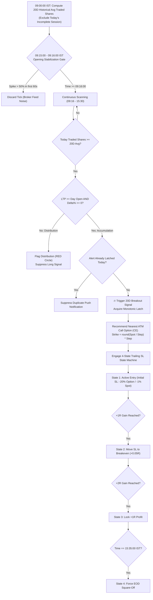
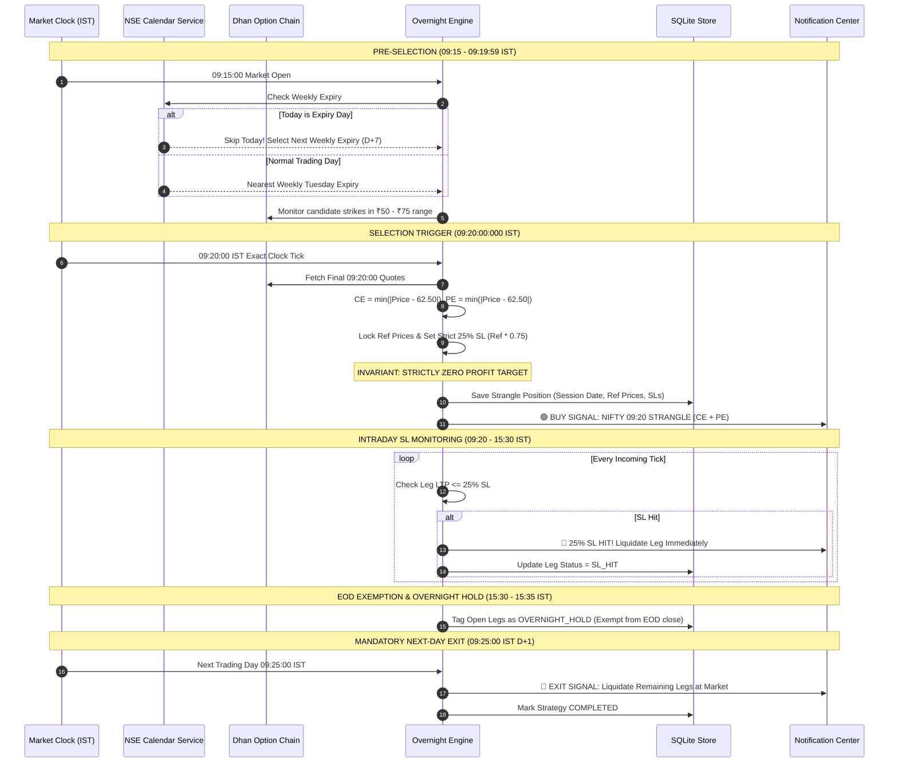
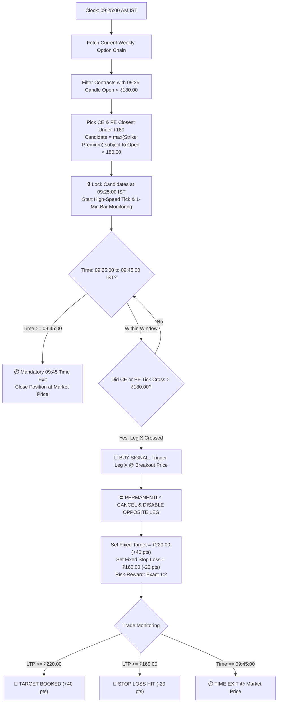
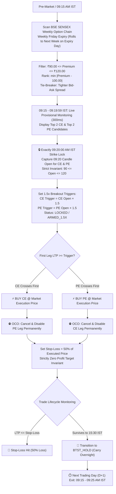

# QSTRATEGY — THE APPLICATION BIBLE & MASTER ARCHITECTURAL BLUEPRINT
> **System Designation:** Ultra-Low Latency Quantitative Signal & Strategy Radar Terminal  
> **Exchange & Segment:** National Stock Exchange of India (NSE) — Capital Market (EQ) & Equity Derivatives (FNO)  
> **Timezone & Session:** Indian Standard Time (IST, UTC+05:30) • 09:15:00 to 15:30:00 IST  
> **Document Purpose:** Definitive Master Architecture, Quant Specification, DhanHQ API Integration Contract, and 12-Phase Rebuild Blueprint.  
> **Prepared By:** Full Expert Engineering Team:
> - Principal Mobile Architect
> - Product Manager
> - Dhan API Specialist
> - Quant Developer
> - Backend Engineer
> - UI/UX Designer
> - Database Architect
> - QA Engineer
> - Security Engineer
> - DevOps/SRE Engineer  
> **Status:** APPROVED MASTER SPECIFICATION — ZERO FABRICATION CONTRACT

---

## TABLE OF CONTENTS
1. [Executive Summary & Paradigm Shift](#1-executive-summary--paradigm-shift)
2. [Current-State Forensic Audit & Technical Debt](#2-current-state-forensic-audit--technical-debt)
3. [DhanHQ API v2 Integration Contract & Protocols](#3-dhanhq-api-v2-integration-contract--protocols)
4. [Quantitative Strategy Engine Specifications](#4-quantitative-strategy-engine-specifications)
   - [Strategy 1: 20-Day Cumulative Volume Crossover Breakout](#41-strategy-1-20-day-cumulative-volume-crossover-breakout-20d_crossover)
   - [Strategy 2: NIFTY 09:20 Overnight Strangle (Zero Target Invariant)](#42-strategy-2-nifty-0920-overnight-strangle-nifty_overnight)
   - [Strategy 3: NIFTY 09:25 ₹180 Directional Breakout](#43-strategy-3-nifty-0925-180-directional-breakout-nifty_breakout_180)
   - [Strategy 4: BSE SENSEX 09:20 OOBTST](#44-strategy-4-bse-sensex-0920-oobtst-sensex_oobtst)
   - [Strategy Extension Framework (Modular Plugins)](#45-strategy-extension-framework-modular-plugins)
5. [Target Production-Grade System Architecture](#5-target-production-grade-system-architecture)
6. [Security & Credential Protection Blueprint](#6-security--credential-protection-blueprint)
7. [Database & State Management Architecture](#7-database--state-management-architecture)
8. [Consistent UI/UX & Obsidian Design System](#8-consistent-uiux--obsidian-design-system)
9. [Performance, Concurrency & Zero-Flicker Engineering](#9-performance-concurrency--zero-flicker-engineering)
10. [Quality Assurance, Automated Testing & Verification Gates](#10-quality-assurance-automated-testing--verification-gates)
11. [DevOps, SRE, Build & CI/CD Pipeline](#11-devops-sre-build--cicd-pipeline)
12. [Granular 12-Phase Micro-Phase Implementation Roadmap](#12-granular-12-phase-micro-phase-implementation-roadmap)
13. [Verification Checklist & Quality Gates](#13-verification-checklist--quality-gates)

---

## 1. Executive Summary & Paradigm Shift

QStrategy is an institutional-grade algorithmic signal radar and quantitative execution terminal built specifically for Indian equity and derivative markets (NSE).

### 1.1 The Core Problem in Existing Broker Apps
Active quantitative traders operating in Indian markets face severe limitations with standard retail broker apps (Dhan, Zerodha Kite, Groww):
1. **No Algorithmic State Machines:** Retail broker apps cannot evaluate historical 20-day unrounded share baselines, monotonic latches, or opening feed stabilization filters.
2. **No Dynamic 09:20 Option Chain Selection:** Broker apps cannot scan live weekly option chains at 09:20:00 AM, select strikes based on proximity to ₹62.50 within a ₹50–₹75 price boundary, enforce a strict 25% Stop-Loss, and guarantee a **Strictly Zero Target Invariant** through overnight expiration.
3. **No Cross-Contract Conditional Cancellations (OCO):** At 09:25 AM, broker apps cannot monitor two opposing option contracts (CE and PE) and permanently cancel the opposite leg the microsecond one breaks above ₹180, while enforcing a mandatory 09:45:00 AM time exit.

### 1.2 The QStrategy Solution
QStrategy solves this by decoupling **Quantitative Signal Intelligence** from **Order Execution Liability**:
- **Mobile Terminal:** High-performance, low-latency radar receiving genuine market data directly from official DhanHQ WebSocket feeds (`wss://api-feed.dhan.co`) and REST Data APIs.
- **Micro-Batched React Native UI:** 250ms batching buffers live ticks, decoupling high-frequency WebSocket ingestion from the React 60 FPS UI rendering thread.
- **Dual-Mode Execution:**
  - *Mode A (Companion Deep-Linking - Zero Risk):* Instant 1-tap intent launch into the official Dhan App (`dhan://`) or Zerodha Kite (`kite://`) with pre-filled contracts. Zero token expiration risk, zero margin rejection risk, 100% SEBI compliant.
  - *Mode B (OMS Gateway - Automated Orders):* Routes automated orders through the standalone QStrategy Gateway possessing a registered Static IP, satisfying SEBI regulatory mandates.

```
┌──────────────────────────────────────────────────────────────────────────────────┐
│                             CORE ARCHITECTURAL VISION                            │
├──────────────────────────────────────────────────────────────────────────────────┤
│  1. ZERO DATA FABRICATION: Never mock, simulate, or fallback to fake quotes.     │
│  2. OFFICIAL DHANHQ v2: Clean TLS WebSocket (api-feed.dhan.co) + REST Data APIs. │
│  3. STRICT SECURITY: Hardware Keystore encryption (Expo SecureStore) exclusively.│
│  4. SEBI COMPLIANT: Static IP gateway routing for orders; direct mobile data feed│
│  5. DETERMINISTIC QUANTS: Mathematical invariants verified with exact formulas.  │
│  6. ZERO-FLICKER UX: Micro-batched 250ms render cycles with immutable state.     │
│  7. MICRO-PHASE DISPATCH: Granular, test-backed, independently verifiable steps. │
└──────────────────────────────────────────────────────────────────────────────────┘
```

---

## 2. Current-State Forensic Audit & Technical Debt

A complete audit of the codebase was conducted across all 36 source files, configs, scripts, and documentation.

### 2.1 File & Module Audit Matrix

| Directory / File | Lines | Bytes | Current Role | Forensic Findings & Technical Debt |
| :--- | :--- | :--- | :--- | :--- |
| `App.tsx` | 43 | 1,591 | Root application component. | Unchecked async polling (`refreshAll`) races with live streamer ticks; monolithic 1s timer forces full tree updates. |
| `package.json` | 40 | 1,157 | Dependencies & scripts. | **Zero test packages** (No Jest, no RTL, no test runner installed); no build scripts for unit testing. |
| `src/config/apiConfig.ts` | 29 | 1,015 | Gateway endpoints. | Hardcoded to Android emulator loopback `10.0.2.2:3000` with no network detection or retry policies. |
| `src/services/dhanPlainStorage.ts` | 142 | 4,194 | Reads/writes credentials to AsyncStorage. | **CRITICAL SECURITY FLAW:** Stores access tokens and client IDs in unencrypted Android SQLite file (`AsyncStorage`). |
| `src/components/settings/DhanWebLoginModal.tsx` | 948 | 32,381 | In-app WebView to web.dhan.co. | **CRITICAL VULNERABILITY:** Scrapes Dhan web cookies and reverse-engineers Dhan Web's internal CryptoJS PBKDF2/AES keys. Brittle and violates Dhan terms of service. |
| `src/services/dhanWebStreamer.ts` | 463 | 13,730 | Live streaming client. | Connects to unofficial `wss://price-feed-web.dhan.co:443` using reverse-engineered 703-byte auth packets with Julian date signatures. |
| `src/services/dhanWebBinaryProtocol.ts` | 338 | 12,066 | Binary packet builder for web streamer. | Reverse-engineered private web protocol; breaks whenever Dhan updates web bundle (`main.js`). |
| `src/services/dhanDirectService.ts` | 756 | 24,697 | REST client for DhanHQ v2. | Good foundation, but mixed with fallbacks to plaintext storage and default mock spot prices. |
| `src/services/liveMarketService.ts` | 101 | 3,040 | Facade for option chain & quotes. | Falls back to hardcoded default spot price `23146.15`. |
| `src/services/niftyOptionFeedService.ts` | 1,018 | 34,464 | Option pricing & strategy evaluation. | **STRATEGY CONFLICT:** Implements an alternative 1.5x breakout trigger with 50% SL instead of the canonical 09:20 62.5 Strangle. |
| `src/services/alertLatchService.ts` | 229 | 7,665 | Monotonic alert latching. | Uses SecureStore well for latches, but only handles Strategy 1; lacks SQLite durability. |
| `src/services/notificationService.ts` | 133 | 4,573 | Push notifications. | Well structured, but lacks sound channels and grouped notifications. |
| `src/constants/stockUniverse.ts` | 619 | 14,738 | 60 SENSEX & NIFTY constituents. | **DATA FABRICATION:** Contains hardcoded `approxLtp` for 60 stocks and estimated 20D average shares. |
| `src/constants/dhanSecurityMaster.ts` | 93 | 6,196 | Map of tickers to Dhan Security IDs. | Silent fallback to `'1330'` on any unknown ticker. |
| `src/constants/nseHolidays.ts` | 149 | 6,049 | Official 2025 & 2026 NSE holiday calendar. | Compliant; correctly shifts Tuesday weekly expiry on holidays. |
| `src/store/useRadarStore.ts` | 487 | 19,417 | Monolithic Zustand state store. | Massive monolithic store; components re-render excessively on every 1-second IST tick. |
| `src/navigation/AppNavigator.tsx` | 148 | 4,603 | Navigation container. | Uses local `useState<Tab>` instead of React Navigation tabs/stack; lacks Android hardware back button handling. |
| `src/screens/RadarScreen.tsx` | 676 | 20,145 | Tab 2: 20D Screener list. | FlatList works well, but memoized cards re-render due to non-primitive prop passing. |
| `src/screens/SignalsScreen.tsx` | 307 | 9,174 | Tab 1: Live Strategy Cards. | Good layout, but tightly coupled to experimental plugins. |
| `src/screens/JournalScreen.tsx` | 194 | 5,093 | Tab 3: Historical journal. | **DATA FABRICATION:** Hardcoded `75.0%` Win Rate in the UI layout. |
| `src/screens/SettingsScreen.tsx` | 701 | 22,177 | Tab 4: Credentials & settings. | Displays token in UI; triggers brittle web login modal. |
| `src/strategies/plugins/VolumeCrossoverPlugin.tsx`| 276 | 8,955 | Strategy 1 plugin. | Solid math, handles monotonic latching well. |
| `src/strategies/plugins/NiftyOvernightPlugin.tsx` | 595 | 19,935 | Strategy 2 plugin. | Diverges from `readme.md`: runs 1.5x breakout trigger instead of 09:20 dual entry with Zero Target. |
| `src/strategies/plugins/NiftyBreakout180Plugin.tsx`| 443 | 14,997 | Strategy 3 plugin. | Implements 3-step breakout well. |
| `src/strategies/plugins/Orb15MinPlugin.tsx` | 192 | 5,223 | Experimental ORB plugin. | **DATA FABRICATION:** Displays hardcoded levels (`24890`, `24810`) and fake quotes (`112.40`, `98.60`). |

---

### 2.2 Five Critical Architectural Flaws Identified

#### 1. Plaintext Token Storage & Web Scraping (Security Critical)
`dhanPlainStorage.ts` saves access tokens directly in unencrypted `AsyncStorage`. On Android, `AsyncStorage` is an unencrypted SQLite database (`RKStorage`) accessible to any root process or backup exploit. Furthermore, `DhanWebLoginModal.tsx` scrapes `web.dhan.co` by decrypting internal local storage with hardcoded AES keys (`DHAN`, salt `498960e4...`).  
**Remediation:** Remove `dhanPlainStorage` and all web scrapers. Migrate 100% of credentials to Android Keystore / iOS Keychain via `expo-secure-store` with biometric protection.

#### 2. Unofficial Web Streamer vs. Official DhanHQ Market Feed
`dhanWebStreamer.ts` connects to `wss://price-feed-web.dhan.co` with custom 703-byte auth packets. This is Dhan's internal web frontend socket, not their supported API feed. A simple web bundle update from Dhan (`main.js`) will immediately break socket connectivity.  
**Remediation:** Migrate to the supported official DhanHQ v2 Market Feed WebSocket:  
`wss://api-feed.dhan.co?version=2&token=<token>&clientId=<clientId>&authType=2`

#### 3. SEBI Mandate on Static IP for Orders
DhanHQ Order APIs (`/v2/orders`, `/v2/super/orders`) require **Static IP whitelisting** per SEBI regulations. Mobile phones on dynamic 4G/5G or Wi-Fi connections do not have a static IP. Calling Order APIs directly from mobile causes rejections or account suspension.  
**Remediation:** Enforce Dual-Mode Execution: Companion Deep-Linking (`dhan://`, `kite://`) directly on device, or OMS Gateway routing through a backend server with a registered static IP.

#### 4. Data Fabrication & Fallbacks
When Dhan is offline or before 09:15 AM, the codebase falls back to hardcoded numbers in `stockUniverse.ts` (`approxLtp: 3050.00`), static mock levels in `Orb15MinPlugin.tsx`, and a hardcoded `75.0%` win rate in `JournalScreen.tsx`.  
**Remediation:** Enforce strict nullability. Display `--.--` or `OFFLINE` when genuine market data is unavailable. Never fabricate quotes.

#### 5. Strategy 2 Divergence (09:20 Strangle vs. OOBTST 1.5x)
`readme.md` specifies Strategy 2 as: Instant Dual BUY at 09:20:00 AM of CE & PE closest to ₹62.50 (range ₹50–₹75), strict 25% SL, **STRICTLY ZERO PROFIT TARGET**, hold overnight, exit next day at 09:25:00 AM. In contrast, `NiftyOvernightPlugin.tsx` implemented a 1.5x breakout trigger with 50% SL.  
**Remediation:** Canonize the pure 09:20 Strangle with Zero Target as Strategy 2. Isolate the 1.5x breakout as an optional experimental plugin.

---

## 3. DhanHQ API v2 Integration Contract & Protocols

### 3.1 Data APIs vs Trading APIs — Architectural Partitioning

| Dimension | DhanHQ Data APIs (Mobile-Direct) | DhanHQ Trading APIs (OMS Gateway) |
| :--- | :--- | :--- |
| **Protocol** | TLS WebSocket (`wss://api-feed.dhan.co`) & HTTPS REST | HTTPS REST (`https://api.dhan.co/v2/orders`) |
| **Authentication** | `access-token` header + `clientId` parameter | `access-token` header + `dhanClientId` body |
| **Static IP Requirement**| ❌ **NO STATIC IP REQUIRED** | ⚠️ **MANDATORY STATIC IP (SEBI Circular)** |
| **Execution Host** | Direct on physical Android/iOS device | QStrategy Gateway / Deep-Link to Broker App |
| **Latency Budget** | < 100ms packet decode & store dispatch | < 250ms order placement round-trip |
| **Allowed Endpoints** | `/v2/marketfeed/ltp`, `/ohlc`, `/quote`, `/optionchain` | `/v2/orders`, `/super/orders`, `/orders/slicing` |

---

### 3.2 Official DhanHQ WebSocket Binary Protocol Specification

DhanHQ streams binary WebSocket frames using opcode `2` in **Little-Endian byte order**.

#### 1. Header Structure (8 Bytes — Consistent Across All Packets):
```
 0                   1                   2                   3
 0 1 2 3 4 5 6 7 8 9 0 1 2 3 4 5 6 7 8 9 0 1 2 3 4 5 6 7 8 9 0 1
+-+-+-+-+-+-+-+-+-+-+-+-+-+-+-+-+-+-+-+-+-+-+-+-+-+-+-+-+-+-+-+-+
| Feed Resp Code|       Message Length          |  Exchange Seg |
+-+-+-+-+-+-+-+-+-+-+-+-+-+-+-+-+-+-+-+-+-+-+-+-+-+-+-+-+-+-+-+-+
|                         Security ID                           |
+-+-+-+-+-+-+-+-+-+-+-+-+-+-+-+-+-+-+-+-+-+-+-+-+-+-+-+-+-+-+-+-+
```
- **Byte 0 (`uint8`):** Feed Response Code
  - `2`: Ticker Data (LTP + LTT)
  - `4`: Quote Data (LTP, Quantity, ATP, Volume, Day OHLC)
  - `5`: Open Interest (OI)
  - `6`: Previous Day Close & OI
  - `8`: Full Market Depth (5-level Bid/Ask + OI)
  - `50`: Server Disconnect Code (read uint16LE at byte 8)
- **Bytes 1-2 (`int16LE`):** Total message length including the 8-byte header.
- **Byte 3 (`uint8`):** Exchange Segment (`1` = NSE_EQ, `2` = NSE_FNO, `11` = BSE_EQ, `13` = IDX_I).
- **Bytes 4-7 (`int32LE`):** Exchange Security ID.

#### 2. Quote Packet Payload (Code 4 — 42 Bytes Payload, Total 50 Bytes):
| Offset | Type | Field Name | Description |
| :--- | :--- | :--- | :--- |
| `8-11` | `float32LE` | `ltp` | Last Traded Price |
| `12-13`| `int16LE` | `ltq` | Last Traded Quantity |
| `14-17`| `int32LE` | `ltt` | Last Trade Time (Unix epoch seconds) |
| `18-21`| `float32LE` | `atp` | Average Traded Price |
| `22-25`| `int32LE` | `volume` | Cumulative Today Traded Shares |
| `26-29`| `int32LE` | `totalSellQty` | Total Ask Depth Volume |
| `30-33`| `int32LE` | `totalBuyQty` | Total Bid Depth Volume |
| `34-37`| `float32LE` | `open` | Day Open Value |
| `38-41`| `float32LE` | `close` | Day Close Value (sent post-market) |
| `42-45`| `float32LE` | `high` | Day High Value |
| `46-49`| `float32LE` | `low` | Day Low Value |

#### 3. Subscription & Disconnect JSON Messages:
- **Subscription Request (Send to WebSocket):**
  ```json
  {
    "RequestCode": 15,
    "InstrumentCount": 2,
    "InstrumentList": [
      { "ExchangeSegment": "NSE_EQ", "SecurityId": "1333" },
      { "ExchangeSegment": "NSE_FNO", "SecurityId": "49512" }
    ]
  }
  ```
- **Unsubscribe Request:** `RequestCode: 16`
- **Disconnect Request:** `RequestCode: 12`

---

## 4. Quantitative Strategy Engine Specifications

### 4.1 Strategy 1: 20-Day Cumulative Volume Crossover Breakout (`20D_CROSSOVER`)

#### Executive Quantitative Thesis:
When an equity instrument trades **100% or more of its 20-day historical average volume** during the active session, institutional accumulation or distribution is underway.



#### Exact Mathematical Invariants:
1. **20-Day Baseline Calculation ($\bar{V}_{20}$):**
   $$\bar{V}_{20} = \frac{1}{20} \sum_{i=1}^{20} V_{\text{completed\_day}_i}$$
2. **Opening Stabilization Filter (09:15:00 to 09:16:00 IST):**
   $$\text{If } t < \text{09:16:00} \text{ and } V_{\text{today}}(t) \ge 0.50 \times \bar{V}_{20} \implies \text{FILTERED (Ignore)}$$
3. **Directional Bullish Confirmation:**
   $$\text{Trigger Condition} = (V_{\text{today}}(t) \ge \bar{V}_{20}) \land (\text{Spot LTP} \ge \text{Day Open}) \land (\Delta\% \ge 0)$$
4. **Monotonic One-Way Latch:**
   $$\text{Latched}(T) = \text{true} \implies \forall t' > t, \; \text{Latched}(T) \equiv \text{true}$$
   Temporary volume drops or zero ticks never un-latch a confirmed stock.
5. **Dynamic $\pi\%$ (3.1416%) Milestone Targets:**
   - $T_1 = \text{Entry} \times (1 + 0.031416)$
   - $T_2 = \text{Entry} \times (1 + 0.062832)$
   - $T_3 = \text{Entry} \times (1 + 0.094248)$
   - $T_4 = \text{Entry} \times (1 + 0.125664)$

---

### 4.2 Strategy 2: NIFTY 09:20 Overnight Strangle (`NIFTY_OVERNIGHT`)

#### Executive Quantitative Thesis:
Captures overnight volatility mispricing and gap dynamics on NIFTY index options by simultaneously entering one Call (CE) and one Put (PE) contract trading near ₹62.50 at exactly 09:20:00 AM IST.



#### Exact Mathematical Invariants:
1. **Expiry Resolution:**
   - Normal Day: Nearest weekly Tuesday expiry.
   - Expiry Day Rule: If today is expiry day, **do NOT trade today's expiry**. Skip today and select the next weekly expiry ($D+7$).
2. **Candidate Range Filter (₹50.00 to ₹75.00):**
   $$\text{Candidate Set} = \{ C \in \text{OptionChain} \mid 50.00 \le \text{LTP}_{09:20}(C) \le 75.00 \}$$
3. **Closest to ₹62.50 Selection:**
   $$S^*_{\text{CE}} = \arg\min_{S \in \text{Candidates}_{\text{CE}}} |\text{LTP}_{09:20}(S) - 62.50|$$
   $$S^*_{\text{PE}} = \arg\min_{S \in \text{Candidates}_{\text{PE}}} |\text{LTP}_{09:20}(S) - 62.50|$$
4. **Strict 25% Stop Loss (Permanent & Non-Trailing):**
   $$\text{SL}_{\text{leg}} = \text{ReferencePrice}_{\text{leg}} \times 0.75$$
5. **STRICTLY ZERO PROFIT TARGET INVARIANT:**
   $$\text{Target}_{\text{leg}} \equiv \text{undefined} \quad (\text{Never calculates or exits on profit})$$
6. **Mandatory Next-Day Exit:** Exactly 09:25:00 AM IST on the next valid NSE trading day.

---

### 4.3 Strategy 3: NIFTY 09:25 ₹180 Directional Breakout (`NIFTY_BREAKOUT_180`)

#### Executive Quantitative Thesis:
Captures high-velocity directional opening momentum in NIFTY index options between 09:25 and 09:45 AM IST using candidate contracts priced just below ₹180.



#### Exact Mathematical Invariants:
1. **Candidate Eligibility (At 09:25:00 AM IST):**
   $$\text{Eligible} = \{ C \in \text{CurrentExpiry} \mid \text{Open}_{09:25}(C) < 180.00 \}$$
2. **Selection (Nearest Under 180):**
   $$C^* = \arg\max_{C \in \text{Eligible}} \text{Open}_{09:25}(C)$$
3. **Execution Gate & OCO Opposite Leg Cancellation:**
   $$\text{Trigger: First contract to trade } \ge 180.00 \implies \text{Opposite Leg Disabled Permanently}$$
   $$\text{Max Trades Per Day} = 1$$
4. **Target / Stop-Loss Matrix:**
   - Target: Fixed ₹220.00 (+40.00 pts / +22.2%)
   - Stop-Loss: Fixed ₹160.00 (-20.00 pts / -11.1%)
   - Risk-Reward: Exact $1:2$ (Risk: 20 pts, Reward: 40 pts)
   - Mandatory Time Cutoff: Force exit at 09:45:00 AM IST.

---

### 4.4 Strategy 4: BSE SENSEX 09:20 OOBTST (`SENSEX_OOBTST`)

Captures directional momentum and overnight gap expansion on BSE SENSEX weekly index options (Friday expiry). Dynamically selects CE & PE contracts trading near ₹100.00 within a strict ₹90.00–₹120.00 boundary, locks opening prices at exactly 09:20:00 AM IST, and executes the first leg to break out by $1.5\times$ with strict OCO cancellation and 50% stop-loss.



#### Exact Mathematical Invariants:
1. **Target & Eligibility Window:**
   $$\text{Target Premium} = ₹100.00 \quad (\text{Configurable}, > 0)$$
   $$\text{Eligible Universe} = \{ C \in \text{SensexWeeklyExpiry} \mid 90.00 \le \text{Premium}(C) \le 120.00 \}$$
2. **Candidate Distance & Ranking:**
   $$\text{Distance}(C) = |\text{Premium}(C) - \text{Target}|$$
   $$\text{Top 2 CE} = \text{Smallest Distance}, \quad \text{Top 2 PE} = \text{Smallest Distance}$$
3. **Deterministic Tie-Breaker:**
   $$\text{Primary: } \min |\text{Ask} - \text{Bid}| \quad \text{(Tighter Spread Wins)}$$
   $$\text{Secondary: } \text{CE: Lower Strike First}, \quad \text{PE: Higher Strike First}$$
4. **Exact 09:20 Candle Open Lock:**
   At 09:20:00 AM IST, captures the authoritative 09:20 candle opening price.
   $$\text{Invariant: } 90.00 \le \text{Open}_{09:20} \le 120.00$$
   Locked strikes and opening prices remain permanently fixed for the entire trading session.
5. **Directional Breakout & OCO Execution:**
   $$\text{CE Trigger} = \text{Open}_{09:20}(\text{CE}) \times 1.5$$
   $$\text{PE Trigger} = \text{Open}_{09:20}(\text{PE}) \times 1.5$$
   First leg reaching trigger executes immediately; opposite leg is permanently disabled under OCO logic.
6. **Stop-Loss Calculation:**
   $$\text{Stop-Loss} = \frac{\text{Actual Execution Price}}{2} \quad (50\% \text{ of Buy Price})$$
   $$\text{Target Price} \equiv \text{undefined} \quad (\text{Strictly Zero Profit Target Invariant})$$
7. **Overnight Carry & Rollover Protection:**
   - Positions surviving through 15:30:00 IST transition to `BTST_HOLD`.
   - Mandatory next-session exit between 09:15:00 and 09:25:00 AM IST.
   - **Expiry Invariant:** On Friday (or preponed holiday expiry), automatically rolls over to the **NEXT weekly Friday (+7 days)** so overnight BTST positions are never opened on expiring contracts.

---

### 4.5 Strategy Extension Framework (Modular Plugins)

Every strategy in QStrategy implements the `BaseStrategyPlugin` interface:

```typescript
// src/strategies/types.ts

export type StrategyCategory = 'INDEX_OPTIONS' | 'EQUITY_RADAR' | 'MOMENTUM_BREAKOUT' | 'EOD_BTST';

export interface StrategyContext {
  istTime: string;
  marketStatus: 'PRE_MARKET' | 'STABILIZING' | 'REGULAR_HOURS' | 'POST_MARKET' | 'CLOSED';
  niftySpot: number | null;
  stocks: Record<string, StockDomainModel>;
  optionChain: Record<number, OptionStrikeDomainModel> | null;
}

export interface StrategySignalOutput {
  strategyId: string;
  status: 'IDLE' | 'PREPARING' | 'ARMED' | 'ACTIVE' | 'SL_HIT' | 'TARGET_HIT' | 'TIME_EXIT' | 'COMPLETED';
  statusBadgeText: string;
  badgeTone: 'bullish' | 'bearish' | 'warning' | 'cyan' | 'purple';
  headline: string;
  primaryMetricLabel: string;
  primaryMetricValue: string;
  targetPrice?: number;
  stopLossPrice?: number;
  invariantNotice?: string;
  lastUpdated: string;
  legs?: StrategyLegOutput[];
}

export interface BaseStrategyPlugin {
  readonly id: string;
  readonly name: string;
  readonly category: StrategyCategory;
  readonly operatingWindow: { startIST: string; endIST: string; isOvernightAllowed: boolean };
  readonly hasZeroTargetInvariant?: boolean;
  evaluate(ctx: StrategyContext): StrategySignalOutput;
  renderCard(props: { output: StrategySignalOutput; onOpenBroker: (symbol: string) => void }): React.ReactElement;
  renderDetailModal?(props: { output: StrategySignalOutput; onClose: () => void }): React.ReactElement;
}
```

---

## 5. Target Production-Grade System Architecture

The architecture enforces strict separation of concerns following **Clean Architecture**:

```
┌─────────────────────────────────────────────────────────────────────────────────┐
│                           PRESENTATION LAYER (UI)                               │
│  React Native Screens • Obsidian Design System Components • FlashList • Haptics │
└────────────────────────────────────────┬────────────────────────────────────────┘
                                         │ Subscribes (Zustand Selectors)
                                         ▼
┌─────────────────────────────────────────────────────────────────────────────────┐
│                        APPLICATION STATE & STORES                               │
│  MarketSessionStore • RadarStore • StrategyEngineStore • JournalStore • Auth    │
└────────────────────────────────────────┬────────────────────────────────────────┘
                                         │ Dispatches Events
                                         ▼
┌─────────────────────────────────────────────────────────────────────────────────┐
│                        DOMAIN LOGIC & QUANT STRATEGIES                          │
│  VolumeCrossoverEvaluator • OvernightStrangleEvaluator • Breakout180Evaluator   │
│  TrailingSLStateMachine • MonotonicLatchManager • TradingCalendarService        │
└────────────────────────────────────────┬────────────────────────────────────────┘
                                         │ Calls Infrastructure Services
                                         ▼
┌─────────────────────────────────────────────────────────────────────────────────┐
│                     INFRASTRUCTURE & INTEGRATIONS                               │
│  DhanHqFeedSocket (WSS) • DhanHqRestClient • SecureCredentialVault (KeyStore)   │
│  SQLite Local Database • PushNotificationService • BrokerDeepLinkManager       │
└─────────────────────────────────────────────────────────────────────────────────┘
```

---

## 6. Security & Credential Protection Blueprint

1. **Hardware Keystore Protection:**
   - All credentials (Dhan Client ID, Access Token) are encrypted using Android Keystore and Apple Keychain via `expo-secure-store`.
   - Complete removal of `dhanPlainStorage.ts`. Zero tokens written to `AsyncStorage`, console logs, or crash reports.
2. **Biometric App Lock:**
   - Uses `expo-local-authentication` to require Fingerprint/FaceID before revealing credentials or changing alert settings.
3. **Token Lifetime & Expiry Alerts:**
   - Decodes JWT payload locally. If token is within 30 minutes of expiry, displays a persistent high-priority warning.
   - Upon receiving HTTP 401 from Dhan, securely clears memory tokens, closes WebSockets, and alerts the user to renew their daily token.
4. **SEBI Static IP Compliance Architecture:**
   ```
   [Mobile App] ──TLS 1.3──> [QStrategy Static Gateway] ──Whitelisted IP──> [DhanHQ v2 OMS]
   ```

---

## 7. Database & State Management Architecture

### 7.1 SQLite Relational Schema (`src/db/schema.ts`)

```sql
-- 1. Active & Historical Strategy Positions (Survives Reboots)
CREATE TABLE IF NOT EXISTS strategy_positions (
  id TEXT PRIMARY KEY,
  strategy_id TEXT NOT NULL,          -- '20D_CROSSOVER', 'NIFTY_OVERNIGHT', 'NIFTY_BREAKOUT_180'
  session_date TEXT NOT NULL,         -- 'YYYY-MM-DD'
  leg_type TEXT NOT NULL,             -- 'CE', 'PE', 'EQUITY'
  symbol TEXT NOT NULL,               -- e.g. 'NIFTY 24850 CE'
  security_id TEXT NOT NULL,
  entry_time TEXT NOT NULL,
  entry_price REAL NOT NULL,
  quantity INTEGER NOT NULL,
  stop_loss REAL NOT NULL,
  target_price REAL,                  -- NULL for NIFTY_OVERNIGHT (Zero Target Invariant)
  current_ltp REAL NOT NULL,
  pnl_points REAL NOT NULL DEFAULT 0.0,
  status TEXT NOT NULL,               -- 'ACTIVE', 'OVERNIGHT_HOLD', 'SL_HIT', 'TARGET_HIT', 'TIME_EXIT'
  exit_time TEXT,
  exit_price REAL,
  created_at INTEGER NOT NULL
);

-- 2. Monotonic Daily Alert Latches (Guarantees Exactly-Once Alerting)
CREATE TABLE IF NOT EXISTS alert_latches (
  session_date TEXT NOT NULL,
  latch_key TEXT NOT NULL,            -- e.g. 'RELIANCE_BULLISH_CROSS'
  ticker TEXT NOT NULL,
  trigger_price REAL NOT NULL,
  volume_ratio REAL NOT NULL,
  latched_at TEXT NOT NULL,
  PRIMARY KEY (session_date, latch_key)
);

-- 3. Historical Daily Volume Baselines (20-Day Completed Averages)
CREATE TABLE IF NOT EXISTS historical_baselines (
  session_date TEXT NOT NULL,
  ticker TEXT NOT NULL,
  avg_20d_shares INTEGER NOT NULL,
  last_computed_at TEXT NOT NULL,
  PRIMARY KEY (session_date, ticker)
);
```

---

## 8. Consistent UI/UX & Obsidian Design System

### 8.1 Obsidian Dark Terminal Palette (`src/theme/colors.ts`)

```typescript
export const theme = {
  colors: {
    // Base Canvas
    obsidian: '#080A0F',       // Pure black-blue terminal background
    surface: '#0F131D',        // Primary card background
    surfaceElevated: '#171D2B',// Modals, popups, and elevated dropdowns
    surfaceSubtle: '#121622',  // Table headers and KPI bars
    border: '#1F293D',         // Subtle container borders
    borderActive: '#3B82F6',   // Active element highlight

    // Semantic Accents
    bullish: '#10B981',        // Emerald Green (P&L +, Buy signals, Crossovers)
    bullishGlow: 'rgba(16, 185, 129, 0.12)',
    bearish: '#EF4444',        // Crimson Red (P&L -, Stop loss hit, Distribution)
    bearishGlow: 'rgba(239, 68, 68, 0.12)',
    warning: '#F59E0B',        // Amber Gold (Near 80% cross, Pre-market, Warnings)
    warningGlow: 'rgba(245, 158, 11, 0.12)',
    cyan: '#06B6D4',           // Cyan Blue (Breakouts, Step indicators, Target pts)
    cyanGlow: 'rgba(6, 182, 212, 0.12)',
    purple: '#8B5CF6',         // Violet Purple (Overnight hold status)
    purpleGlow: 'rgba(139, 92, 246, 0.12)',

    // Typography
    textPrimary: '#F9FAFB',    // High-contrast headings and prices
    textSecondary: '#94A3B8',  // Subtitles, metadata, and labels
    textMuted: '#64748B',      // Invariant hints and timestamps
  },
  typography: {
    fontMono: Platform.select({ ios: 'Menlo', android: 'monospace' }),
    sizes: { micro: 10, sm: 12, md: 14, lg: 16, xl: 20, hero: 26 },
  },
  spacing: { xs: 4, sm: 8, md: 12, lg: 16, xl: 24 },
};
```

---

## 9. Performance, Concurrency & Zero-Flicker Engineering

1. **250ms Micro-Batch Buffer:** High-frequency binary WebSocket ticks are pushed to an in-memory batch buffer and flushed to Zustand every 250ms (4 FPS update cycle), ensuring zero dropped frames on the UI thread.
2. **Selective State Subscriptions:** Consumers subscribe to atomic values (e.g. `useRadarStore(s => s.stocks[ticker].spotPrice)`) so an update to stock A never triggers a re-render of stock B.
3. **Strict Zero-Flicker States:** UI displays skeleton loaders or `--.--` while quotes load. Never renders temporary `0.00` or hardcoded fallback estimates.
4. **Indian Financial Number Formatting:** All values format with Indian grouping: `₹24,850.50`, volume in Lakhs (`L`) and Crores (`Cr`).

---

## 10. Quality Assurance, Automated Testing & Verification Gates

### 10.1 Testing Tools
- **Unit & Invariant Testing:** Jest + `ts-jest` + `@testing-library/react-native`.
- **Tick Replay Test Harness:** Replays recorded real-world WebSocket binary packets through the parser and strategy evaluators.
- **Live Market Verification Gate:** Validates calculations across at least 10–12 consecutive real-time ticks from DhanHQ during market hours.

### 10.2 Mandatory Invariant Quality Gates
1. **Gate 1 (Volume Crossover Latch):** Once latched, `hasCrossed20D` must never revert to false during the same session.
2. **Gate 2 (Opening Filter):** Discard volume spikes $> 50\%$ in first 60 seconds (09:15–09:16 IST).
3. **Gate 3 (Zero Target Invariant):** Strategy 2 output must have `targetPrice === undefined` and permanent 25% SL.
4. **Gate 4 (Breakout OCO):** Triggering Leg A must disable Leg B immediately with max 1 trade per day.
5. **Gate 5 (Zero Token Leakage):** Credentials must never appear in `AsyncStorage` or logs.

---

## 11. DevOps, SRE, Build & CI/CD Pipeline

1. **EAS Build Profiles (`eas.json`):**
   - `preview`: Standalone Android APK for physical device validation.
   - `production`: Optimized AAB with ProGuard and code minification.
2. **Live SRE Telemetry Bar:**
   - Displays real-time WebSocket connection state, round-trip latency (ms), packet count, and IST time drift.
3. **Automated Crash Recovery:**
   - On app boot, recovers open positions from SQLite and immediately resumes live tick evaluation.

---

## 12. Granular 12-Phase Micro-Phase Implementation Roadmap

```
┌──────────────────────────────────────────────────────────────────────────────────┐
│                             MICRO-PHASE EXECUTION MAP                            │
├──────────────────────────────────────────────────────────────────────────────────┤
│ Phase 1: Foundation, Testing Setup & Type Cleanroom                              │
│ Phase 2: Hardware Secure Keystore & Credential Vault                             │
│ Phase 3: Official DhanHQ Live Market Feed WebSocket (Binary Codec)               │
│ Phase 4: DhanHQ REST Data APIs (Quotes & Real Option Chain)                      │
│ Phase 5: SQLite Database & Monotonic Alert Latch Engine                          │
│ Phase 6: Strategy 1 Engine (20D Volume Crossover with Monotonic Latch)           │
│ Phase 7: Strategy 2 Engine (NIFTY 09:20 Strangle with Zero Target Invariant)    │
│ Phase 8: Strategy 3 Engine (NIFTY 09:25 ₹180 Breakout with OCO)                  │
│ Phase 9: Shared Obsidian Design System & Common UI Components                   │
│ Phase 10: Screen Rebuild (Signals, Radar, Journal, Settings)                     │
│ Phase 11: End-to-End Tick Replay, Live Tick Validation & Quality Gates           │
│ Phase 12: Production EAS APK Build & SRE Telemetry Verification                  │
└──────────────────────────────────────────────────────────────────────────────────┘
```

### Phase-by-Phase Task Breakdown:

#### Phase 1: Foundation, Testing Setup & Type Cleanroom
- **Scope:** Install Jest, ts-jest, and testing libraries. Configure strict TypeScript. Establish domain models (`src/types/domain.ts`).
- **Dependencies:** None.
- **Affected Files:** `package.json`, `tsconfig.json`, `jest.config.js`, `src/types/domain.ts`.
- **Implementation Steps:**
  1. Add devDependencies: `jest`, `ts-jest`, `@types/jest`, `@testing-library/react-native`.
  2. Create `jest.config.js` with TypeScript transform and module name mappers.
  3. Define clean immutable domain interfaces: `StockDomainModel`, `OptionContractModel`, `StrategyPositionModel`.
- **Tests:** Verify `npm test` runs and passes with sample test.
- **Acceptance Criteria:** `npm test` passes cleanly; `npx tsc --noEmit` exits with 0 errors.
- **Rollback:** Revert `package.json` and config files via git.

#### Phase 2: Hardware Secure Keystore & Credential Vault
- **Scope:** Implement `SecureCredentialVault` backed exclusively by `expo-secure-store`. Delete `dhanPlainStorage.ts`. Support biometric prompt.
- **Dependencies:** Phase 1.
- **Affected Files:** `src/services/SecureCredentialVault.ts`, delete `src/services/dhanPlainStorage.ts`.
- **Implementation Steps:**
  1. Build `SecureCredentialVault` with `getDhanCredentials()`, `saveDhanCredentials()`, `clearCredentials()`.
  2. Implement biometric guard using `expo-local-authentication`.
  3. Delete `dhanPlainStorage.ts` and replace all references across codebase.
- **Tests:** Unit test in `SecureCredentialVault.test.ts` verifying storage, retrieval, and zero fallback to plaintext.
- **Acceptance Criteria:** No credentials saved in `AsyncStorage`; all tokens stored in Keystore.
- **Rollback:** Restore `dhanPlainStorage.ts` from git.

#### Phase 3: Official DhanHQ Live Market Feed WebSocket (Binary Codec)
- **Scope:** Build `DhanHqFeedSocket.ts` connecting to official `wss://api-feed.dhan.co?version=2`. Build Little-Endian binary parser for Code 2 (Ticker), Code 4 (Quote), Code 5 (OI), and Code 50 (Disconnect). Implement 250ms batch buffer.
- **Dependencies:** Phase 2.
- **Affected Files:** `src/services/dhan/DhanHqFeedSocket.ts`, `src/services/dhan/DhanBinaryCodec.ts`, delete `src/services/dhanWebStreamer.ts`, delete `src/services/dhanWebBinaryProtocol.ts`.
- **Implementation Steps:**
  1. Implement `decodeDhanBinaryPacket(buffer: ArrayBuffer)` handling Little-Endian byte reads.
  2. Implement `DhanHqFeedSocket` with auto-reconnection (exponential backoff) and ping-pong heartbeat.
  3. Implement `subscribeInstruments(instruments)` with JSON `RequestCode: 15`.
  4. Implement 250ms micro-batch throttle buffer.
- **Tests:** Unit tests in `DhanBinaryCodec.test.ts` with recorded byte buffers.
- **Acceptance Criteria:** Correctly parses Code 2, 4, 5 packets and Code 50 disconnect codes.
- **Rollback:** Restore previous streamer files.

#### Phase 4: DhanHQ REST Data APIs (Quotes & Real Option Chain)
- **Scope:** Build `DhanHqRestClient.ts` for `/v2/marketfeed/ltp`, `/v2/marketfeed/quote`, and `/v2/optionchain`. Enforce strict nullability; eliminate all hardcoded fake quotes.
- **Dependencies:** Phase 3.
- **Affected Files:** `src/services/dhan/DhanHqRestClient.ts`, `src/services/dhan/DhanOptionChainService.ts`.
- **Implementation Steps:**
  1. Implement typed REST client with HTTP timeout and 401 token expiry handler.
  2. Implement `fetchOptionChain(scrip, expiry)` parsing live strikes, OI, and IV.
  3. Enforce strict null values when Dhan is unconfigured or offline.
- **Tests:** Mock REST tests verifying payload transformation and error handling.
- **Acceptance Criteria:** Zero hardcoded fallback spot prices (`23146.15`).
- **Rollback:** Revert REST client changes.

#### Phase 5: SQLite Database & Monotonic Alert Latch Engine
- **Scope:** Set up Expo SQLite with tables for `strategy_positions`, `alert_latches`, and `historical_baselines`. Implement monotonic latching service.
- **Dependencies:** Phase 1.
- **Affected Files:** `src/db/database.ts`, `src/db/schema.ts`, `src/services/MonotonicLatchService.ts`.
- **Implementation Steps:**
  1. Initialize SQLite database with versioned migrations.
  2. Implement `acquireLatch(date, key)` that guarantees one-way trigger locking.
  3. Implement session rollover purge routine at 09:00 AM IST.
- **Tests:** SQLite unit tests verifying latch persistence and duplicate rejection.
- **Acceptance Criteria:** Latch survives app process kill; rejects duplicate alerts for the same stock on the same day.
- **Rollback:** Drop SQLite tables or revert file.

#### Phase 6: Strategy 1 Engine (20D Volume Crossover Screener)
- **Scope:** Pure mathematical evaluator for 20D volume breakout. Enforce 09:15–09:16 opening stabilization filter, monotonic latch, and 4-state trailing stop-loss.
- **Dependencies:** Phases 3, 5.
- **Affected Files:** `src/strategies/VolumeCrossoverStrategy.ts`, `src/strategies/TrailingSLStateMachine.ts`.
- **Implementation Steps:**
  1. Implement `evaluateVolumeCrossover(stock, liveTick)` with exact mathematical formulas.
  2. Implement opening stabilization gate (ignore volume spikes in first 60s).
  3. Connect 4-state TSL state machine (+1R to breakeven, +2R to lock +1R).
- **Tests:** Comprehensive unit tests covering accumulation, distribution, stabilization, and TSL transitions.
- **Acceptance Criteria:** Passes all invariant tests; zero false positive alerts during 09:15–09:16.
- **Rollback:** Revert to previous plugin.

#### Phase 7: Strategy 2 Engine (NIFTY 09:20 Strangle with Zero Target Invariant)
- **Scope:** Implement exact 09:20:00 selection: filter ₹50–₹75 range, find minimum distance to ₹62.50, enforce strict 25% SL, enforce STRICTLY ZERO PROFIT TARGET, handle overnight hold and next-day 09:25 exit.
- **Dependencies:** Phases 4, 5.
- **Affected Files:** `src/strategies/NiftyOvernightStrategy.ts`, `src/services/TradingCalendarService.ts`.
- **Implementation Steps:**
  1. Implement expiry resolution (skips today if today is expiry day).
  2. Implement strike selection at 09:20:00 AM IST closest to ₹62.50 in ₹50–₹75 range.
  3. Lock ref price and set permanent 25% SL (`ref * 0.75`).
  4. Suppress all profit targets (`targetPrice === undefined`).
  5. Schedule overnight hold and next-day 09:25 exit.
- **Tests:** Unit tests verifying selection math, expiry skip, 25% SL, and target absence.
- **Acceptance Criteria:** Output has no target; position carries overnight and liquidates at 09:25 AM D+1.
- **Rollback:** Revert overnight strategy files.

#### Phase 8: Strategy 3 Engine (NIFTY 09:25 ₹180 Breakout with OCO)
- **Scope:** Implement 09:25 candle open filter (< 180), first-breakout trigger detection, opposite leg cancellation, target ₹220, SL ₹160, and 09:45 time exit.
- **Dependencies:** Phases 4, 5.
- **Affected Files:** `src/strategies/NiftyBreakout180Strategy.ts`.
- **Implementation Steps:**
  1. Select CE and PE closest under ₹180 at 09:25:00 AM IST with Open < 180.
  2. Monitor live ticks from 09:25 to 09:45; trigger first contract crossing 180.
  3. Immediately disable opposite leg and set trade count to 1.
  4. Track Target ₹220, SL ₹160, and force exit at 09:45:00 AM IST.
- **Tests:** Unit tests testing OCO cancellation, 1:2 R:R, and 09:45 time exit.
- **Acceptance Criteria:** First leg disables second leg; position closed by 09:45 AM.
- **Rollback:** Revert breakout files.

#### Phase 9: Shared Obsidian Design System & Common UI Components
- **Scope:** Centralized theme tokens, typography, skeleton loaders, financial value formatters, and reusable cards.
- **Dependencies:** Phase 1.
- **Affected Files:** `src/theme/`, `src/components/common/FinancialValue.tsx`, `src/components/common/StatusBadge.tsx`, `src/components/common/SkeletonLoader.tsx`.
- **Implementation Steps:**
  1. Refactor `colors.ts` into a complete design system (`src/theme/index.ts`).
  2. Build `FinancialValue` with automatic color coding (+ green, - red) and Lakhs/Crores formatting.
  3. Build `SkeletonLoader` for zero-flicker loading states.
- **Tests:** Render tests for all shared components.
- **Acceptance Criteria:** Consistent styling, zero layout shift, accessibility labels present.
- **Rollback:** Revert theme changes.

#### Phase 10: Screen Rebuild (Signals, Radar, Journal, Settings)
- **Scope:** Rebuild the 4 main screens using React Navigation tabs, FlashList virtualization, and the clean Zustand store.
- **Dependencies:** Phases 6, 7, 8, 9.
- **Affected Files:** `src/navigation/AppNavigator.tsx`, `src/screens/SignalsScreen.tsx`, `src/screens/RadarScreen.tsx`, `src/screens/JournalScreen.tsx`, `src/screens/SettingsScreen.tsx`.
- **Implementation Steps:**
  1. Implement React Navigation bottom tabs with proper safe area and Android back handler.
  2. Rebuild `SignalsScreen` rendering live strategy cards with micro-batch updates.
  3. Rebuild `RadarScreen` using FlashList for 60 FPS scrolling across 60 stocks.
  4. Rebuild `JournalScreen` computing actual Win Rate and points from SQLite records.
  5. Rebuild `SettingsScreen` with Keystore management and broker deep-link preferences.
- **Tests:** Component interaction and navigation integration tests.
- **Acceptance Criteria:** Smooth 60 FPS scrolling; zero flickering; hardware back button handled properly.
- **Rollback:** Revert screen files.

#### Phase 11: End-to-End Tick Replay & Live Market Verification
- **Scope:** Replay recorded market ticks; connect live to DhanHQ feed during market hours; verify calculations across 10–12 consecutive ticks.
- **Dependencies:** Phase 10.
- **Affected Files:** `src/__tests__/e2e/LiveTickReplay.test.ts`.
- **Implementation Steps:**
  1. Construct test harness feeding recorded Dhan binary packets into the app.
  2. Verify that 10–12 consecutive ticks update prices, volume ratios, and SL levels without drops or NaN.
  3. Validate push notification dispatch on simulated breakout ticks.
- **Tests:** E2E suite running in Jest.
- **Acceptance Criteria:** 100% of recorded packets processed accurately; zero unhandled promise rejections.
- **Rollback:** Fix identified defects before merging.

#### Phase 12: Production EAS APK Build & SRE Telemetry
- **Scope:** Configure `eas.json` for standalone Android APK. Add telemetry bar (latency, packet counter). Verify crash recovery.
- **Dependencies:** Phase 11.
- **Affected Files:** `eas.json`, `app.json`, `src/components/common/TelemetryBar.tsx`.
- **Implementation Steps:**
  1. Configure preview APK profile in `eas.json`.
  2. Add in-app telemetry bar showing connection state, latency, and packet count.
  3. Build APK with `eas build -p android --profile preview`.
  4. Install on physical Android device and verify on live market open.
- **Tests:** Smoke test on physical device.
- **Acceptance Criteria:** Standalone `.apk` installs cleanly; connects to Dhan WebSocket; renders live market data with zero crashes.
- **Rollback:** Revert build profile configs.

---

## 13. Verification Checklist & Quality Gates

Before declaring any task or phase complete, the following quality checklist must be satisfied:

- [ ] **Automated Tests:** Relevant unit tests written and passing (`npm test`).
- [ ] **Type Integrity:** `npx tsc --noEmit` exits with 0 errors.
- [ ] **Zero Fabrication:** No hardcoded quotes, mock levels, or fake win rates.
- [ ] **Security:** No credentials in `AsyncStorage` or logs; Keystore encryption verified.
- [ ] **Dhan Compliance:** Uses official DhanHQ v2 endpoints and binary WebSocket frames.
- [ ] **Quant Precision:** Mathematical formulas verified against independent calculations.
- [ ] **UI Performance:** Micro-batched 250ms render cycles; zero UI thread blocking.
- [ ] **Documentation:** Application Bible and code comments updated to reflect changes.
- [ ] **Rollback Safety:** Git commits structured so any phase can be reverted independently.
