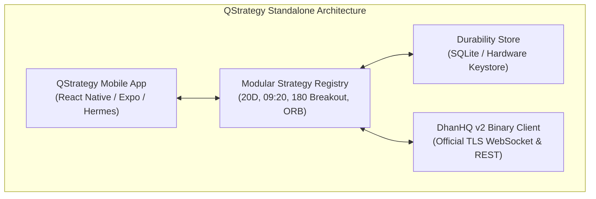
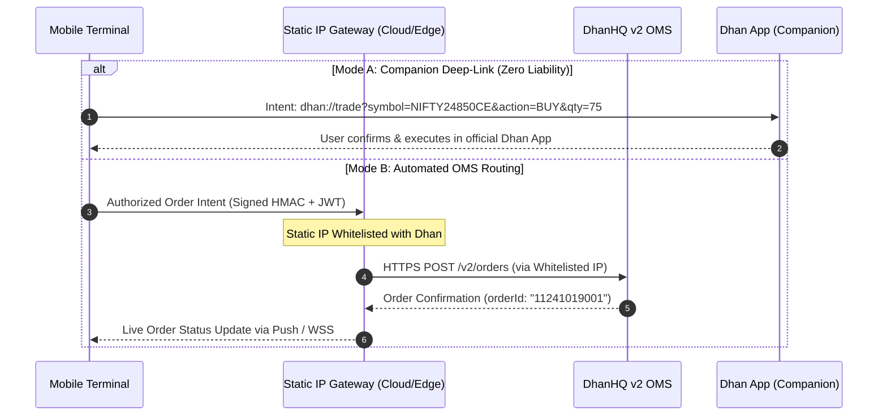
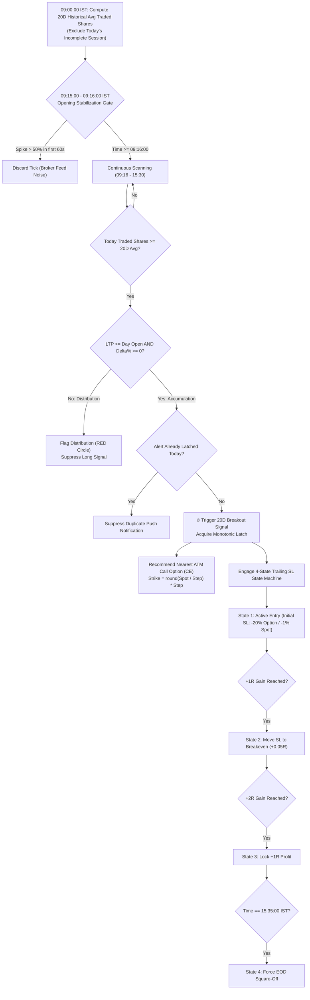
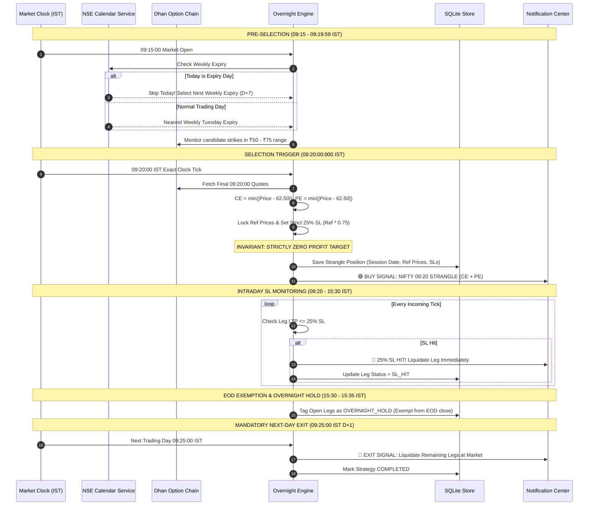
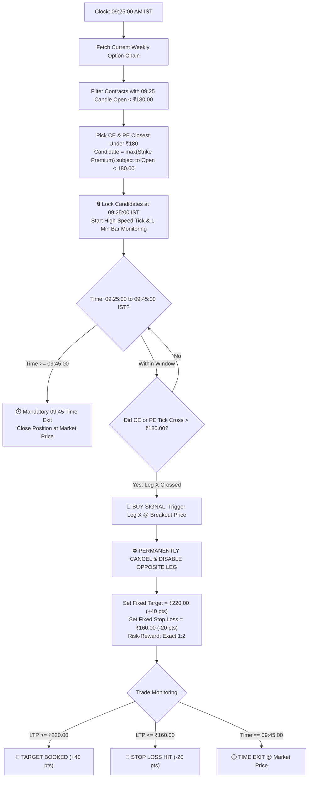

# QSTRATEGY — STANDALONE MOBILE & ALGO TRADING PLATFORM
# Integration Specification & Master Engineering Blueprint (`Integration.md`)

> **System Designation:** Standalone Institutional-Grade Mobile Trading Terminal & Algorithmic Strategy Engine  
> **Benchmark Standard:** Dhan Trading App (Option Chain-Centric, Multi-Leg, Low-Latency, Zero-Flicker)  
> **Exchange & Segment:** National Stock Exchange of India (NSE) — Equity (EQ) & Equity Derivatives (FNO)  
> **Market Timezone:** Indian Standard Time (IST, UTC+05:30) • 09:00:00 to 15:35:00 IST  
> **Target Repository:** [`c:\Project\QStrategy`](file:///c:/Project/QStrategy) (Standalone Architecture)  
> **Status:** APPROVED MASTER INTEGRATION SPECIFICATION — ZERO FABRICATION CONTRACT  

---

## TABLE OF CONTENTS
1. [Executive Architectural Vision & Paradigm](#1-executive-architectural-vision--paradigm)
2. [Multi-Repository Ecosystem Topology](#2-multi-repository-ecosystem-topology)
3. [DhanHQ API v2 Integration Contract & Binary Wire Protocol](#3-dhanhq-api-v2-integration-contract--binary-wire-protocol)
4. [SEBI Compliance, Static IP Architecture & Risk Management (RMS)](#4-sebi-compliance-static-ip-architecture--risk-management-rms)
5. [Delivering the Dhan Trading App Experience on Mobile](#5-delivering-the-dhan-trading-app-experience-on-mobile)
6. [Distributed Engine-Split Architecture (Edge Cloud + Mobile Terminal)](#6-distributed-engine-split-architecture-edge-cloud--mobile-terminal)
7. [Universal Strategy Plugin Architecture](#7-universal-strategy-plugin-architecture)
   - [7.1 Strategy 1: 20D Cumulative Volume Crossover Breakout](#71-strategy-1-20d-cumulative-volume-crossover-breakout-20d_crossover)
   - [7.2 Strategy 2: NIFTY 09:20 Overnight Strangle (Zero Target Invariant)](#72-strategy-2-nifty-0920-overnight-strangle-nifty_overnight)
   - [7.3 Strategy 3: NIFTY 09:25 ₹180 Directional Breakout (OCO)](#73-strategy-3-nifty-0925-180-directional-breakout-nifty_breakout_180)
   - [7.4 Strategy 4: BSE SENSEX 09:20 OOBTST](#74-strategy-4-bse-sensex-0920-oobtst-sensex_oobtst)
   - [7.5 Onboarding Strategies from BackTest (15-Min ORB, 3:10 PM BTST)](#75-onboarding-strategies-from-backtest-15-min-orb-310-pm-btst)
8. [Database Schema & Local SQLite Persistence](#8-database-schema--local-sqlite-persistence)
9. [Obsidian Design System & Zero-Flicker UI Engineering](#9-obsidian-design-system--zero-flicker-ui-engineering)
10. [Granular 12-Phase Micro-Implementation Roadmap](#10-granular-12-phase-micro-implementation-roadmap)
11. [Verification Gates & Quality Assurance Checklist](#11-verification-gates--quality-assurance-checklist)

---

## 1. Executive Architectural Vision & Paradigm

The platform solves the two greatest friction points facing Indian quantitative and systematic retail traders:
1. **The Inability of Retail Broker Apps to Run Custom Quantitative Logic:** Traditional broker apps (Dhan, Zerodha Kite, Groww) cannot evaluate unrounded 20-day historical volume baselines, opening feed stabilization filters, dynamic 09:20 option chain selections with zero profit targets, or cross-contract One-Cancels-Other (OCO) breakout gates.
2. **The High Failure Rate of Pure Mobile Algo Execution:** Running an algo engine exclusively on a mobile device is fatal in production. Mobile operating systems (Android Doze Mode and iOS Background App Refresh) terminate or throttle background JavaScript within minutes. If a 25% Stop-Loss occurs while the phone is locked, the trade will fail to exit.

### The Solution: The Distributed Engine-Split Architecture
- **Cloud/Edge Quant Worker (Static IP Gateway):** Headless, 24/7 high-reliability worker with a registered Static IP. It ingests the DhanHQ live feed, evaluates strategy state machines, monitors stop-losses, and routes orders per SEBI mandates.
- **Mobile Terminal (Dhan-Grade Client):** Ultra-responsive React Native app providing live Option Chains with Greeks, dynamic Strategy Radar cards, sub-second P&L updates, push notifications, and 1-tap companion broker deep-linking.

```
┌──────────────────────────────────────────────────────────────────────────────────┐
│                             CORE ARCHITECTURAL VISION                            │
├──────────────────────────────────────────────────────────────────────────────────┤
│  1. ZERO DATA FABRICATION: Never mock, simulate, or fallback to fake quotes.     │
│  2. OFFICIAL DHANHQ v2: Clean TLS WebSocket (api-feed.dhan.co) + REST Data APIs. │
│  3. HARDWARE KEYSTORE: Android Keystore & Apple Keychain (expo-secure-store).    │
│  4. SEBI COMPLIANT: Static IP gateway routing for orders; direct mobile data feed│
│  5. DETERMINISTIC QUANTS: Mathematical invariants verified with exact formulas.  │
│  6. ZERO-FLICKER UX: Micro-batched 250ms render cycles with immutable state.     │
│  7. DHAN BENCHMARK: Live Option Chain, Greeks, Moneyness shading, Sliced orders. │
└──────────────────────────────────────────────────────────────────────────────────┘
```

---

## 2. Standalone Application Architecture & Boundaries

**QStrategy** is engineered as a fully standalone, autonomous application. It does not depend on, bundle with, or sub-ordinate to external projects. It maintains its own complete mobile runtime, strategy registry, SQLite database, and Static IP Gateway connectivity.



### 2.1 Complete Architectural Autonomy
1. **Self-Contained Mobile Terminal:** The root directory houses the entire React Native / Expo application (`App.tsx`, `package.json`, `app.json`, `src/`).
2. **Decoupled Strategy Plugins:** Each algorithmic strategy runs via clean domain interfaces (`BaseStrategyPlugin`), allowing any quantitative model to run locally or remotely without third-party web scrapers.
3. **Independent Broker Connectivity:** Connects directly to DhanHQ official v2 binary streams and REST APIs with Hardware Keystore credentials (`expo-secure-store`).

---

## 3. DhanHQ API v2 Integration Contract & Binary Wire Protocol

### 3.1 Data APIs vs Trading APIs — Architectural Partitioning

| Dimension | DhanHQ Data APIs (Mobile-Direct) | DhanHQ Trading APIs (OMS Gateway) |
| :--- | :--- | :--- |
| **Protocol** | TLS WebSocket (`wss://api-feed.dhan.co`) & HTTPS REST | HTTPS REST (`https://api.dhan.co/v2/orders`) |
| **Authentication** | `access-token` header + `clientId` parameter | `access-token` header + `dhanClientId` body |
| **Static IP Requirement**| ❌ **NO STATIC IP REQUIRED** | ⚠️ **MANDATORY STATIC IP (SEBI Circular)** |
| **Execution Host** | Direct on physical Android/iOS device | QStrategy Gateway / Deep-Link to Broker App |
| **Latency Budget** | < 100ms packet decode & store dispatch | < 250ms order placement round-trip |
| **Allowed Endpoints** | `/v2/marketfeed/ltp`, `/ohlc`, `/quote`, `/optionchain` | `/v2/orders`, `/super/orders`, `/orders/slicing` |

---

### 3.2 Official DhanHQ WebSocket Binary Protocol Specification

The official DhanHQ v2 binary market feed streams via:  
`wss://api-feed.dhan.co?version=2&token=<access-token>&clientId=<dhan-client-id>&authType=2`

All packets use WebSocket binary opcode `2` formatted in **Little-Endian (LE)** byte order.

#### 1. Universal Header (8 Bytes — Consistent Across All Packets):
```
 0                   1                   2                   3
 0 1 2 3 4 5 6 7 8 9 0 1 2 3 4 5 6 7 8 9 0 1 2 3 4 5 6 7 8 9 0 1
+-+-+-+-+-+-+-+-+-+-+-+-+-+-+-+-+-+-+-+-+-+-+-+-+-+-+-+-+-+-+-+-+
| Feed Resp Code|       Message Length          |  Exchange Seg |
+-+-+-+-+-+-+-+-+-+-+-+-+-+-+-+-+-+-+-+-+-+-+-+-+-+-+-+-+-+-+-+-+
|                         Security ID                           |
+-+-+-+-+-+-+-+-+-+-+-+-+-+-+-+-+-+-+-+-+-+-+-+-+-+-+-+-+-+-+-+-+
```
- **Byte 0 (`uint8`):** Feed Response Code
  - `2`: Ticker Data (LTP + LTT)
  - `4`: Full Quote Data (LTP, Quantity, ATP, Volume, Day OHLC, Buy/Sell Qty)
  - `5`: Open Interest (OI)
  - `6`: Previous Day Close & OI
  - `8`: Full Market Depth (5-level Bid/Ask + OI)
  - `50`: Server Disconnect Code (inspect uint16LE at byte 8)
- **Bytes 1-2 (`int16LE`):** Total message length in bytes including header.
- **Byte 3 (`uint8`):** Exchange Segment (`1` = NSE_EQ, `2` = NSE_FNO, `11` = BSE_EQ, `13` = IDX_I).
- **Bytes 4-7 (`int32LE`):** Exchange Security ID.

#### 2. Ticker Packet Payload (Code 2 — 8 Bytes Payload, 16 Bytes Total):
| Offset | Type | Field Name | Description |
| :--- | :--- | :--- | :--- |
| `8-11` | `float32LE` | `ltp` | Last Traded Price |
| `12-15`| `int32LE` | `ltt` | Last Trade Time (Unix epoch seconds) |

#### 3. Quote Packet Payload (Code 4 — 42 Bytes Payload, 50 Bytes Total):
| Offset | Type | Field Name | Description |
| :--- | :--- | :--- | :--- |
| `8-11` | `float32LE` | `ltp` | Last Traded Price |
| `12-13`| `int16LE` | `ltq` | Last Traded Quantity |
| `14-17`| `int32LE` | `ltt` | Last Trade Time (Unix epoch seconds) |
| `18-21`| `float32LE` | `atp` | Average Traded Price |
| `22-25`| `int32LE` | `volume` | Cumulative Today Traded Shares |
| `26-29`| `int32LE` | `totalSellQty` | Total Ask Depth Volume |
| `30-33`| `int32LE` | `totalBuyQty` | Total Bid Depth Volume |
| `34-37`| `float32LE` | `open` | Day Open Value |
| `38-41`| `float32LE` | `close` | Day Close Value (sent post-market) |
| `42-45`| `float32LE` | `high` | Day High Value |
| `46-49`| `float32LE` | `low` | Day Low Value |

#### 4. Disconnect Codes (Code 50):
Read `uint16LE` at byte offset 8:
- `805`: Access Token Expired or Invalid.
- `806`: User Not Subscribed to Data APIs.
- `807`: Maximum Concurrent Connections Exceeded (Limit: 5 active sockets per client).
- `808`: Rate Limit Exceeded (Limit: 25 requests/sec).

#### 5. Subscription JSON Protocol (Outbound):
Send JSON text frame to establish instruments:
```json
{
  "RequestCode": 15,
  "InstrumentCount": 2,
  "InstrumentList": [
    { "ExchangeSegment": "NSE_EQ", "SecurityId": "1333" },
    { "ExchangeSegment": "NSE_FNO", "SecurityId": "49512" }
  ]
}
```

---

## 4. SEBI Compliance, Static IP Architecture & Risk Management (RMS)

### 4.1 SEBI Static IP Compliance Mandate
Under SEBI Circular `SEBI/HO/MIRSD/DOP1/CIR/P/2022/111`, automated order routing requires broker IP whitelisting to prevent unauthorized or untraceable order routing. Calling DhanHQ Trading APIs (`/v2/orders`, `/v2/super/orders`) directly from dynamic cellular networks (4G/5G) is prohibited and results in IP rejection.



### 4.2 Exchange Lot Freeze & Automated Order Slicing
The NSE enforces maximum quantity freeze limits per order to prevent flash crashes:
- **NIFTY 50 Options Freeze Limit:** 1,800 shares (72 lots).
- **BANKNIFTY Options Freeze Limit:** 900 shares (30 lots).

The Order Management Gateway implements automated slicing:
```typescript
export function sliceOrderQuantity(symbol: string, totalShares: number): number[] {
  const FREEZE_LIMITS: Record<string, number> = {
    NIFTY: 1800,
    BANKNIFTY: 900,
    DEFAULT: 1800,
  };
  const limit = FREEZE_LIMITS[symbol] || FREEZE_LIMITS.DEFAULT;
  const slices: number[] = [];
  let remaining = totalShares;

  while (remaining > 0) {
    const chunk = Math.min(remaining, limit);
    slices.push(chunk);
    remaining -= chunk;
  }
  return slices;
}
```

### 4.3 Pre-Trade Risk Management System (RMS) Guardrails
1. **Capital Allocation Ceiling:** Hard limit on maximum deployable capital across open strategies.
2. **Circuit Limit Gate:** Discards entries if spot or option premium is within 2% of upper/lower exchange circuits.
3. **Master Panic Kill-Switch:** 1-tap physical override in app that immediately cancels pending limit/SL orders and liquidates all open positions at market across all strategies.

---

## 5. Delivering the Dhan Trading App Experience on Mobile

To provide a trading experience equal to or better than the official Dhan app, the mobile client implements:

```
┌──────────────────────────────────────────────────────────────────────────────────┐
│                            DHAN-GRADE FEATURE MATRIX                             │
├──────────────────────────────────────────────────────────────────────────────────┤
│ 1. Sub-Second Option Chain: Strikes color-coded by moneyness (ITM / ATM / OTM).  │
│ 2. Live Greeks Engine: On-device Black-Scholes (Delta, Theta, Gamma, Vega, IV).  │
│ 3. PCR & Open Interest Shift: Real-time PCR and OI build-up tags.                │
│ 4. Multi-Leg Strategy Builder: Payoff diagrams, max profit/loss, margin preview. │
│ 5. Instant Order Mode: Single-tap execution with lot size increments.            │
│ 6. Advanced Order Support: Super Orders (Bracket/TSL), Sliced orders.            │
│ 7. Micro-Glow P&L Animations: Green/Red subtle cell glows without layout lag.   │
│ 8. Network SRE Telemetry: Live latency pill (ms), exchange feed health indicator.│
└──────────────────────────────────────────────────────────────────────────────────┘
```

### 5.1 On-Device Black-Scholes Greeks Engine (`src/services/quant/BlackScholes.ts`)

```typescript
export interface OptionGreeks {
  iv: number;
  delta: number;
  gamma: number;
  theta: number;
  vega: number;
}

export function calculateGreeks(
  spot: number,
  strike: number,
  timeToExpiryYears: number,
  riskFreeRate: number,
  marketPrice: number,
  isCall: boolean
): OptionGreeks {
  // Implemented using Newton-Raphson for Implied Volatility (IV)
  // Standard closed-form Black-Scholes for Delta, Gamma, Theta, Vega
  // Computed in sub-millisecond cycles per strike on the mobile Hermes engine
}
```

### 5.2 Micro-Glow P&L Animations & Zero-Flicker Architecture
- Instead of re-rendering entire cards on every incoming tick, price and P&L labels use animated opacity/color transforms:
  - Green tick: `#10B981` flash with 300ms ease-out.
  - Red tick: `#EF4444` flash with 300ms ease-out.
- High-frequency ticks are gathered in a 250ms batch buffer and flushed to Zustand in 4 FPS cycles, completely eliminating UI thread stutter.

---

## 6. Distributed Engine-Split Architecture

```mermaid
flowchart TB
    subgraph MarketFeeds ["NSE Market Ingestion"]
        DhanWSS["DhanHQ v2 Binary WSS<br/>(wss://api-feed.dhan.co)"]
        DhanREST["DhanHQ v2 REST API<br/>(Quotes, Option Chain, Margins)"]
    end

    subgraph StaticGateway ["Edge Server Gateway (Static IP per SEBI)"]
        Ingest["Binary Ingestion & Batching"]
        QuantCore["Headless Quant Strategy Engine<br/>(20D, 09:20 Strangle, 180 Breakout, ORB)"]
        RMS["Risk Management System (RMS)<br/>(Max Drawdown, Lot Slicing, Kill Switch)"]
        OMS["DhanHQ Order Gateway<br/>(Whitelisted Static IP)"]
        PushService["FCM / APNs Push Dispatcher<br/>(Sub-100ms Actionable Alerts)"]
        DB[(SQLite / PostgreSQL Storage)<br/>(Positions, Latches, Baselines)]
    end

    subgraph MobileDevice ["QStrategy Mobile Terminal (React Native / Expo)"]
        MobileFeed["Direct Feed Ingestion<br/>(WSS Client for Low-Latency UI)"]
        StateStore["Zustand State Store<br/>(250ms Micro-Batch Buffer)"]
        UI["Obsidian Design System UI<br/>(Signals, Radar, Option Chain, Journal)"]
        Vault["Secure Keystore Vault<br/>(Biometric Guard + Hardware Encryption)"]
        DeepLink["Broker Deep-Linker<br/>(1-Tap Intent to Dhan / Kite Apps)"]
    end

    DhanWSS -->|Binary Ticks| Ingest
    DhanWSS -->|Direct Marketfeed| MobileFeed
    DhanREST --> Ingest
    DhanREST --> StateStore

    Ingest --> QuantCore
    QuantCore --> RMS
    RMS --> OMS
    OMS -->|Orders| DhanREST
    QuantCore --> DB
    QuantCore -->|Trigger Signals| PushService

    PushService -->|High Priority Push| MobileDevice
    MobileFeed --> StateStore
    StateStore --> UI
    UI --> DeepLink
    DeepLink -->|dhan:// or kite://| BrokerApps["Dhan App / Zerodha Kite"]
    UI -->|Biometric Auth| Vault
    UI -->|Manual Order / Override| OMS
```

---

## 7. Universal Strategy Plugin Architecture

All strategies implement the unified `BaseStrategyPlugin` contract, decoupling mathematical evaluation from presentation.

### 7.1 Strategy 1: 20D Cumulative Volume Crossover Breakout (`20D_CROSSOVER`)

#### Quantitative Thesis:
When an equity instrument trades **100% or more of its 20-day historical average volume** during the active session, institutional accumulation or distribution is underway.



#### Exact Mathematical Invariants:
1. **20-Day Baseline Calculation ($\bar{V}_{20}$):** Computed at 09:00 AM IST strictly from completed daily sessions. Today's candle is excluded:
   $$\bar{V}_{20} = \frac{1}{20} \sum_{i=1}^{20} V_{\text{completed\_day}_i}$$
2. **Opening Stabilization Filter (09:15:00 to 09:16:00 IST):**
   $$\text{If } t < \text{09:16:00} \text{ and } V_{\text{today}}(t) \ge 0.50 \times \bar{V}_{20} \implies \text{FILTERED (Ignore)}$$
3. **Directional Bullish Confirmation:**
   $$\text{Trigger Condition} = (V_{\text{today}}(t) \ge \bar{V}_{20}) \land (\text{Spot LTP} \ge \text{Day Open}) \land (\Delta\% \ge 0)$$
4. **Monotonic One-Way Latch:**
   $$\text{Latched}(T) = \text{true} \implies \forall t' > t, \; \text{Latched}(T) \equiv \text{true}$$
   Intraday volume drops or zero ticks never un-latch a confirmed stock.
5. **Dynamic $\pi\%$ (3.1416%) Milestone Targets:**
   - $T_1 = \text{Entry} \times (1 + 0.031416)$
   - $T_2 = \text{Entry} \times (1 + 0.062832)$
   - $T_3 = \text{Entry} \times (1 + 0.094248)$
   - $T_4 = \text{Entry} \times (1 + 0.125664)$

---

### 7.2 Strategy 2: NIFTY 09:20 Overnight Strangle (`NIFTY_OVERNIGHT`)

#### Quantitative Thesis:
Captures overnight volatility mispricing and gap dynamics on NIFTY index options by simultaneously entering one Call (CE) and one Put (PE) contract trading near ₹62.50 at exactly 09:20:00 AM IST.



#### Exact Mathematical Invariants:
1. **Expiry Resolution:**
   - Normal Day: Nearest weekly Tuesday expiry.
   - Expiry Day Rule: If today is expiry day, **do NOT trade today's expiry**. Skip today and select the next weekly expiry ($D+7$).
2. **Candidate Range Filter (₹50.00 to ₹75.00):**
   $$\text{Candidate Set} = \{ C \in \text{OptionChain} \mid 50.00 \le \text{LTP}_{09:20}(C) \le 75.00 \}$$
3. **Closest to ₹62.50 Selection:**
   $$S^*_{\text{CE}} = \arg\min_{S \in \text{Candidates}_{\text{CE}}} |\text{LTP}_{09:20}(S) - 62.50|$$
   $$S^*_{\text{PE}} = \arg\min_{S \in \text{Candidates}_{\text{PE}}} |\text{LTP}_{09:20}(S) - 62.50|$$
4. **Strict 25% Stop Loss (Permanent & Non-Trailing):**
   $$\text{SL}_{\text{leg}} = \text{ReferencePrice}_{\text{leg}} \times 0.75$$
5. **STRICTLY ZERO PROFIT TARGET INVARIANT:**
   $$\text{Target}_{\text{leg}} \equiv \text{undefined} \quad (\text{Never calculates or exits on profit})$$
6. **Mandatory Next-Day Exit:** Exactly 09:25:00 AM IST on the next valid NSE trading day.

---

### 7.3 Strategy 3: NIFTY 09:25 ₹180 Directional Breakout (`NIFTY_BREAKOUT_180`)

#### Quantitative Thesis:
Captures high-velocity directional opening momentum in NIFTY index options between 09:25 and 09:45 AM IST using candidate contracts priced just below ₹180.



#### Exact Mathematical Invariants:
1. **Candidate Eligibility (At 09:25:00 AM IST):**
   $$\text{Eligible} = \{ C \in \text{CurrentExpiry} \mid \text{Open}_{09:25}(C) < 180.00 \}$$
2. **Selection (Nearest Under 180):**
   $$C^* = \arg\max_{C \in \text{Eligible}} \text{Open}_{09:25}(C)$$
3. **Execution Gate & OCO Opposite Leg Cancellation:**
   $$\text{Trigger: First contract to trade } \ge 180.00 \implies \text{Opposite Leg Disabled Permanently}$$
   $$\text{Max Trades Per Day} = 1$$
4. **Target / Stop-Loss Matrix:**
   - Target: Fixed ₹220.00 (+40.00 pts / +22.2%)
   - Stop-Loss: Fixed ₹160.00 (-20.00 pts / -11.1%)
   - Risk-Reward: Exact $1:2$ (Risk: 20 pts, Reward: 40 pts)
   - Mandatory Time Cutoff: Force exit at 09:45:00 AM IST.

---

### 7.4 Strategy 4: BSE SENSEX 09:20 OOBTST (`SENSEX_OOBTST`)

#### Quantitative Thesis:
Captures directional opening expansion on BSE SENSEX weekly options (Friday expiry). Evaluates eligible CE & PE options in the ₹90–₹120 range targeting ₹100, locks opening prices at 09:20:00 AM IST, triggers an entry on a 1.5x breakout with strict OCO opposing leg cancellation, enforces a 50% stop loss of executed price, and holds surviving trades overnight (BTST) for liquidation next morning (09:15–09:25 AM IST).

#### Exact Mathematical Invariants:
1. **Target & Eligibility Window:**
   $$\text{Target Premium} = ₹100.00 \quad (\text{Configurable}, > 0)$$
   $$\text{Eligible Universe} = \{ C \in \text{SensexWeeklyExpiry} \mid 90.00 \le \text{Premium}(C) \le 120.00 \}$$
2. **Candidate Distance & Ranking:**
   $$\text{Distance}(C) = |\text{Premium}(C) - \text{Target}|$$
   $$\text{Top 2 CE} = \text{Smallest Distance}, \quad \text{Top 2 PE} = \text{Smallest Distance}$$
3. **Deterministic Tie-Breaker:**
   $$\text{Primary: } \min |\text{Ask} - \text{Bid}| \quad \text{(Tighter Spread Wins)}$$
   $$\text{Secondary: } \text{CE: Lower Strike First}, \quad \text{PE: Higher Strike First}$$
4. **Exact 09:20 Candle Open Lock:**
   At 09:20:00 AM IST, captures the authoritative 09:20 candle opening price.
   $$\text{Invariant: } 90.00 \le \text{Open}_{09:20} \le 120.00$$
   Locked strikes and opening prices remain permanently fixed for the entire trading session.
5. **Directional Breakout & OCO Execution:**
   $$\text{CE Trigger} = \text{Open}_{09:20}(\text{CE}) \times 1.5$$
   $$\text{PE Trigger} = \text{Open}_{09:20}(\text{PE}) \times 1.5$$
   First leg reaching trigger executes immediately; opposite leg is permanently disabled under OCO logic.
6. **Stop-Loss Calculation:**
   $$\text{Stop-Loss} = \frac{\text{Actual Execution Price}}{2} \quad (50\% \text{ of Buy Price})$$
   $$\text{Target Price} \equiv \text{undefined} \quad (\text{Strictly Zero Profit Target Invariant})$$
7. **Overnight Carry & Rollover Protection:**
   - Positions surviving through 15:30:00 IST transition to `BTST_HOLD`.
   - Mandatory next-session exit between 09:15:00 and 09:25:00 AM IST.
   - **Expiry Invariant:** On Friday (or preponed holiday expiry), automatically rolls over to the **NEXT weekly Friday (+7 days)** so overnight BTST positions are never opened on expiring contracts.

---

### 7.5 Onboarding Strategies from BackTest (`15-Min ORB` & `3:10 PM BTST`)

The platform's plugin interface allows adding models from [`c:\Project\BackTest`](file:///c:/Project/BackTest) with zero core engine refactoring:

#### 1. 15-Minute Opening Range Breakout (`ORB_15MIN`):
- **Range Definition:** 09:15:00 to 09:30:00 IST opening 15-minute bar high ($H_{15}$) and low ($L_{15}$).
- **Entry Gate:** 09:30:00 to 10:15:00 IST. First 1-min candle close above $H_{15}$ triggers Long; below $L_{15}$ triggers Short.
- **Risk Management:** Initial Stop-Loss at 1% of Spot or 20% of Option premium. Trailing SL engages at $+1R$.

#### 2. 3:10 PM BTST Directional Momentum (`BTST_310PM`):
- **Evaluation Time:** 15:10:00 IST.
- **Criteria:** Stocks trading within 0.5% of Day High with today's volume $\ge 150\%$ of 20D average and positive day delta.
- **Entry:** Near-ATM Call Option (CE) entered at 15:15:00 IST.
- **Exit:** Mandatory exit at 09:20:00 AM IST on next trading day.

---

## 8. Database Schema & Local SQLite Persistence

SQLite is configured via `expo-sqlite` (or cloud PostgreSQL) to guarantee durability across app crashes and reboots:

```sql
-- 1. Active & Historical Strategy Positions (Survives Reboots)
CREATE TABLE IF NOT EXISTS strategy_positions (
  id TEXT PRIMARY KEY,
  strategy_id TEXT NOT NULL,          -- '20D_CROSSOVER', 'NIFTY_OVERNIGHT', 'NIFTY_BREAKOUT_180', 'ORB_15MIN'
  session_date TEXT NOT NULL,         -- 'YYYY-MM-DD'
  leg_type TEXT NOT NULL,             -- 'CE', 'PE', 'EQUITY'
  symbol TEXT NOT NULL,               -- e.g. 'NIFTY 24850 CE'
  security_id TEXT NOT NULL,
  entry_time TEXT NOT NULL,
  entry_price REAL NOT NULL,
  quantity INTEGER NOT NULL,
  stop_loss REAL NOT NULL,
  target_price REAL,                  -- NULL for NIFTY_OVERNIGHT (Zero Target Invariant)
  current_ltp REAL NOT NULL,
  pnl_points REAL NOT NULL DEFAULT 0.0,
  status TEXT NOT NULL,               -- 'ACTIVE', 'OVERNIGHT_HOLD', 'SL_HIT', 'TARGET_HIT', 'TIME_EXIT'
  exit_time TEXT,
  exit_price REAL,
  created_at INTEGER NOT NULL
);

-- 2. Monotonic Daily Alert Latches (Guarantees Exactly-Once Alerting)
CREATE TABLE IF NOT EXISTS alert_latches (
  session_date TEXT NOT NULL,
  latch_key TEXT NOT NULL,            -- e.g. 'RELIANCE_BULLISH_CROSS'
  ticker TEXT NOT NULL,
  trigger_price REAL NOT NULL,
  volume_ratio REAL NOT NULL,
  latched_at TEXT NOT NULL,
  PRIMARY KEY (session_date, latch_key)
);

-- 3. Historical Daily Volume Baselines (20-Day Completed Averages)
CREATE TABLE IF NOT EXISTS historical_baselines (
  session_date TEXT NOT NULL,
  ticker TEXT NOT NULL,
  avg_20d_shares INTEGER NOT NULL,
  last_computed_at TEXT NOT NULL,
  PRIMARY KEY (session_date, ticker)
);
```

---

## 9. Obsidian Design System & Zero-Flicker UI Engineering

### 9.1 Obsidian Color Palette Tokens (`src/theme/colors.ts`)

```typescript
export const theme = {
  colors: {
    // Base Canvas
    obsidian: '#080A0F',        // Pure black-blue terminal background
    surface: '#0F131D',         // Primary card background
    surfaceElevated: '#171D2B', // Modals, popups, and elevated dropdowns
    surfaceSubtle: '#121622',   // Table headers and KPI bars
    border: '#1F293D',          // Subtle container borders
    borderActive: '#3B82F6',    // Active element highlight

    // Semantic Accents
    bullish: '#10B981',         // Emerald Green (P&L +, Buy signals, Crossovers)
    bullishGlow: 'rgba(16, 185, 129, 0.12)',
    bearish: '#EF4444',         // Crimson Red (P&L -, Stop loss hit, Distribution)
    bearishGlow: 'rgba(239, 68, 68, 0.12)',
    warning: '#F59E0B',         // Amber Gold (Near 80% cross, Pre-market, Warnings)
    warningGlow: 'rgba(245, 158, 11, 0.12)',
    cyan: '#06B6D4',            // Cyan Blue (Breakouts, Step indicators, Target pts)
    cyanGlow: 'rgba(6, 182, 212, 0.12)',
    purple: '#8B5CF6',          // Violet Purple (Overnight hold status)
    purpleGlow: 'rgba(139, 92, 246, 0.12)',

    // Typography
    textPrimary: '#F9FAFB',     // High-contrast headings and prices
    textSecondary: '#94A3B8',   // Subtitles, metadata, and labels
    textMuted: '#64748B',       // Invariant hints and timestamps
  },
  typography: {
    fontMono: Platform.select({ ios: 'Menlo', android: 'monospace' }),
    sizes: { micro: 10, sm: 12, md: 14, lg: 16, xl: 20, hero: 26 },
  },
  spacing: { xs: 4, sm: 8, md: 12, lg: 16, xl: 24 },
};
```

---

## 10. Granular 12-Phase Micro-Implementation Roadmap

```
┌──────────────────────────────────────────────────────────────────────────────────┐
│                             MICRO-PHASE EXECUTION MAP                            │
├──────────────────────────────────────────────────────────────────────────────────┤
│ Phase 1: Foundation, Testing Setup & Type Cleanroom                              │
│ Phase 2: Hardware Secure Keystore & Credential Vault                             │
│ Phase 3: Official DhanHQ Live Market Feed WebSocket (Binary Codec)               │
│ Phase 4: DhanHQ REST Data APIs (Quotes & Real Option Chain)                      │
│ Phase 5: SQLite Database & Monotonic Alert Latch Engine                          │
│ Phase 6: Strategy 1 Engine (20D Volume Crossover with Monotonic Latch)           │
│ Phase 7: Strategy 2 Engine (NIFTY 09:20 Strangle with Zero Target Invariant)    │
│ Phase 8: Strategy 3 Engine (NIFTY 09:25 ₹180 Breakout with OCO)                  │
│ Phase 9: Shared Obsidian Design System & Common UI Components                   │
│ Phase 10: Screen Rebuild (Signals, Radar, Option Chain, Journal, Settings)       │
│ Phase 11: End-to-End Tick Replay, Live Tick Validation & Quality Gates           │
│ Phase 12: Production EAS APK Build & SRE Telemetry Verification                  │
└──────────────────────────────────────────────────────────────────────────────────┘
```

### Phase 1: Foundation, Testing Setup & Type Cleanroom
- **Scope:** Install Jest, ts-jest, and testing libraries. Configure strict TypeScript. Establish clean domain models.
- **Affected Files:** `package.json`, `tsconfig.json`, `jest.config.js`, `src/types/domain.ts`.
- **Implementation Steps:**
  1. Add `jest`, `ts-jest`, `@types/jest`, `@testing-library/react-native` to devDependencies.
  2. Create `jest.config.js` with TypeScript transform and module name mappers.
  3. Define clean immutable domain interfaces: `StockDomainModel`, `OptionContractModel`, `StrategyPositionModel`.
- **Tests:** Verify `npm test` runs and passes with a sample unit test.
- **Acceptance Criteria:** `npm test` passes cleanly; `npx tsc --noEmit` exits with 0 errors.
- **Rollback:** Revert `package.json` and config files via git.

### Phase 2: Hardware Secure Keystore & Credential Vault
- **Scope:** Implement `SecureCredentialVault` backed exclusively by `expo-secure-store`. Delete `dhanPlainStorage.ts`. Support biometric prompt.
- **Affected Files:** `src/services/SecureCredentialVault.ts`, delete `src/services/dhanPlainStorage.ts`.
- **Implementation Steps:**
  1. Build `SecureCredentialVault` with `getDhanCredentials()`, `saveDhanCredentials()`, `clearCredentials()`.
  2. Implement biometric guard using `expo-local-authentication`.
  3. Delete `dhanPlainStorage.ts` and replace all references across codebase.
- **Tests:** Unit test in `SecureCredentialVault.test.ts` verifying storage, retrieval, and zero fallback to plaintext.
- **Acceptance Criteria:** No credentials saved in `AsyncStorage`; all tokens stored in Keystore.
- **Rollback:** Restore `dhanPlainStorage.ts` from git.

### Phase 3: Official DhanHQ Live Market Feed WebSocket (Binary Codec)
- **Scope:** Build `DhanHqFeedSocket.ts` connecting to official `wss://api-feed.dhan.co?version=2`. Build Little-Endian binary parser for Code 2 (Ticker), Code 4 (Quote), Code 5 (OI), and Code 50 (Disconnect). Implement 250ms batch buffer.
- **Affected Files:** `src/services/dhan/DhanHqFeedSocket.ts`, `src/services/dhan/DhanBinaryCodec.ts`, delete `src/services/dhanWebStreamer.ts`, delete `src/services/dhanWebBinaryProtocol.ts`.
- **Implementation Steps:**
  1. Implement `decodeDhanBinaryPacket(buffer: ArrayBuffer)` handling Little-Endian byte reads.
  2. Implement `DhanHqFeedSocket` with auto-reconnection (exponential backoff) and ping-pong heartbeat.
  3. Implement `subscribeInstruments(instruments)` with JSON `RequestCode: 15`.
  4. Implement 250ms micro-batch throttle buffer.
- **Tests:** Unit tests in `DhanBinaryCodec.test.ts` with recorded byte buffers.
- **Acceptance Criteria:** Correctly parses Code 2, 4, 5 packets and Code 50 disconnect codes.
- **Rollback:** Restore previous streamer files.

### Phase 4: DhanHQ REST Data APIs (Quotes & Real Option Chain)
- **Scope:** Build `DhanHqRestClient.ts` for `/v2/marketfeed/ltp`, `/v2/marketfeed/quote`, and `/v2/optionchain`. Enforce strict nullability; eliminate all hardcoded fake quotes.
- **Affected Files:** `src/services/dhan/DhanHqRestClient.ts`, `src/services/dhan/DhanOptionChainService.ts`.
- **Implementation Steps:**
  1. Implement typed REST client with HTTP timeout and 401 token expiry handler.
  2. Implement `fetchOptionChain(scrip, expiry)` parsing live strikes, OI, and IV.
  3. Enforce strict null values when Dhan is unconfigured or offline.
- **Tests:** Mock REST tests verifying payload transformation and error handling.
- **Acceptance Criteria:** Zero hardcoded fallback spot prices (`23146.15`).
- **Rollback:** Revert REST client changes.

### Phase 5: SQLite Database & Monotonic Alert Latch Engine
- **Scope:** Set up Expo SQLite with tables for `strategy_positions`, `alert_latches`, and `historical_baselines`. Implement monotonic latching service.
- **Affected Files:** `src/db/database.ts`, `src/db/schema.ts`, `src/services/MonotonicLatchService.ts`.
- **Implementation Steps:**
  1. Initialize SQLite database with versioned migrations.
  2. Implement `acquireLatch(date, key)` that guarantees one-way trigger locking.
  3. Implement session rollover purge routine at 09:00 AM IST.
- **Tests:** SQLite unit tests verifying latch persistence and duplicate rejection.
- **Acceptance Criteria:** Latch survives app process kill; rejects duplicate alerts for the same stock on the same day.
- **Rollback:** Drop SQLite tables or revert file.

### Phase 6: Strategy 1 Engine (20D Volume Crossover Screener)
- **Scope:** Pure mathematical evaluator for 20D volume breakout. Enforce 09:15–09:16 opening stabilization filter, monotonic latch, and 4-state trailing stop-loss.
- **Affected Files:** `src/strategies/VolumeCrossoverStrategy.ts`, `src/strategies/TrailingSLStateMachine.ts`.
- **Implementation Steps:**
  1. Implement `evaluateVolumeCrossover(stock, liveTick)` with exact mathematical formulas.
  2. Implement opening stabilization gate (ignore volume spikes in first 60s).
  3. Connect 4-state TSL state machine (+1R to breakeven, +2R to lock +1R).
- **Tests:** Comprehensive unit tests covering accumulation, distribution, stabilization, and TSL transitions.
- **Acceptance Criteria:** Passes all invariant tests; zero false positive alerts during 09:15–09:16.
- **Rollback:** Revert to previous plugin.

### Phase 7: Strategy 2 Engine (NIFTY 09:20 Strangle with Zero Target Invariant)
- **Scope:** Implement exact 09:20:00 selection: filter ₹50–₹75 range, find minimum distance to ₹62.50, enforce strict 25% SL, enforce STRICTLY ZERO PROFIT TARGET, handle overnight hold and next-day 09:25 exit.
- **Affected Files:** `src/strategies/NiftyOvernightStrategy.ts`, `src/services/TradingCalendarService.ts`.
- **Implementation Steps:**
  1. Implement expiry resolution (skips today if today is expiry day).
  2. Implement strike selection at 09:20:00 AM IST closest to ₹62.50 in ₹50–₹75 range.
  3. Lock ref price and set permanent 25% SL (`ref * 0.75`).
  4. Suppress all profit targets (`targetPrice === undefined`).
  5. Schedule overnight hold and next-day 09:25 exit.
- **Tests:** Unit tests verifying selection math, expiry skip, 25% SL, and target absence.
- **Acceptance Criteria:** Output has no target; position carries overnight and liquidates at 09:25 AM D+1.
- **Rollback:** Revert overnight strategy files.

### Phase 8: Strategy 3 Engine (NIFTY 09:25 ₹180 Breakout with OCO)
- **Scope:** Implement 09:25 candle open filter (< 180), first-breakout trigger detection, opposite leg cancellation, target ₹220, SL ₹160, and 09:45 time exit.
- **Affected Files:** `src/strategies/NiftyBreakout180Strategy.ts`.
- **Implementation Steps:**
  1. Select CE and PE closest under ₹180 at 09:25:00 AM IST with Open < 180.
  2. Monitor live ticks from 09:25 to 09:45; trigger first contract crossing 180.
  3. Immediately disable opposite leg and set trade count to 1.
  4. Track Target ₹220, SL ₹160, and force exit at 09:45:00 AM IST.
- **Tests:** Unit tests testing OCO cancellation, 1:2 R:R, and 09:45 time exit.
- **Acceptance Criteria:** First leg disables second leg; position closed by 09:45 AM.
- **Rollback:** Revert breakout files.

### Phase 9: Shared Obsidian Design System & Common UI Components
- **Scope:** Centralized theme tokens, typography, skeleton loaders, financial value formatters, and reusable cards.
- **Affected Files:** `src/theme/`, `src/components/common/FinancialValue.tsx`, `src/components/common/StatusBadge.tsx`, `src/components/common/SkeletonLoader.tsx`.
- **Implementation Steps:**
  1. Refactor `colors.ts` into a complete design system (`src/theme/index.ts`).
  2. Build `FinancialValue` with automatic color coding (+ green, - red) and Lakhs/Crores formatting.
  3. Build `SkeletonLoader` for zero-flicker loading states.
- **Tests:** Render tests for all shared components.
- **Acceptance Criteria:** Consistent styling, zero layout shift, accessibility labels present.
- **Rollback:** Revert theme changes.

### Phase 10: Screen Rebuild (Signals, Radar, Option Chain, Journal, Settings)
- **Scope:** Rebuild the main screens using React Navigation tabs, FlashList virtualization, and the clean Zustand store.
- **Affected Files:** `src/navigation/AppNavigator.tsx`, `src/screens/SignalsScreen.tsx`, `src/screens/RadarScreen.tsx`, `src/screens/OptionChainScreen.tsx`, `src/screens/JournalScreen.tsx`, `src/screens/SettingsScreen.tsx`.
- **Implementation Steps:**
  1. Implement React Navigation bottom tabs with proper safe area and Android back handler.
  2. Rebuild `SignalsScreen` rendering live strategy cards with micro-batch updates.
  3. Rebuild `RadarScreen` using FlashList for 60 FPS scrolling across 60 stocks.
  4. Build Dhan-grade `OptionChainScreen` with live Greeks and moneyness bands.
  5. Rebuild `JournalScreen` computing actual Win Rate and points from SQLite records.
  6. Rebuild `SettingsScreen` with Keystore management and broker deep-link preferences.
- **Tests:** Component interaction and navigation integration tests.
- **Acceptance Criteria:** Smooth 60 FPS scrolling; zero flickering; hardware back button handled properly.
- **Rollback:** Revert screen files.

### Phase 11: End-to-End Tick Replay & Live Market Verification
- **Scope:** Replay recorded market ticks; connect live to DhanHQ feed during market hours; verify calculations across 10–12 consecutive ticks.
- **Affected Files:** `src/__tests__/e2e/LiveTickReplay.test.ts`.
- **Implementation Steps:**
  1. Construct test harness feeding recorded Dhan binary packets into the app.
  2. Verify that 10–12 consecutive ticks update prices, volume ratios, and SL levels without drops or NaN.
  3. Validate push notification dispatch on simulated breakout ticks.
- **Tests:** E2E suite running in Jest.
- **Acceptance Criteria:** 100% of recorded packets processed accurately; zero unhandled promise rejections.
- **Rollback:** Fix identified defects before merging.

### Phase 12: Production EAS APK Build & SRE Telemetry
- **Scope:** Configure `eas.json` for standalone Android APK. Add telemetry bar (latency, packet counter). Verify crash recovery.
- **Affected Files:** `eas.json`, `app.json`, `src/components/common/TelemetryBar.tsx`.
- **Implementation Steps:**
  1. Configure preview APK profile in `eas.json`.
  2. Add in-app telemetry bar showing connection state, latency, and packet count.
  3. Build APK with `eas build -p android --profile preview`.
  4. Install on physical Android device and verify on live market open.
- **Tests:** Smoke test on physical device.
- **Acceptance Criteria:** Standalone `.apk` installs cleanly; connects to Dhan WebSocket; renders live market data with zero crashes.
- **Rollback:** Revert build profile configs.

---

## 11. Verification Gates & Quality Assurance Checklist

Before declaring any task or phase complete, the following quality checklist must be satisfied:

- [ ] **Automated Tests:** Relevant unit tests written and passing (`npm test`).
- [ ] **Type Integrity:** `npx tsc --noEmit` exits with 0 errors.
- [ ] **Zero Fabrication:** No hardcoded quotes, mock levels, or fake win rates.
- [ ] **Security:** No credentials in `AsyncStorage` or logs; Keystore encryption verified.
- [ ] **Dhan Compliance:** Uses official DhanHQ v2 endpoints and binary WebSocket frames.
- [ ] **Quant Precision:** Mathematical formulas verified against independent calculations.
- [ ] **UI Performance:** Micro-batched 250ms render cycles; zero UI thread blocking.
- [ ] **Documentation:** `Integration.md` and code comments updated to reflect changes.
- [ ] **Rollback Safety:** Git commits structured so any phase can be reverted independently.
